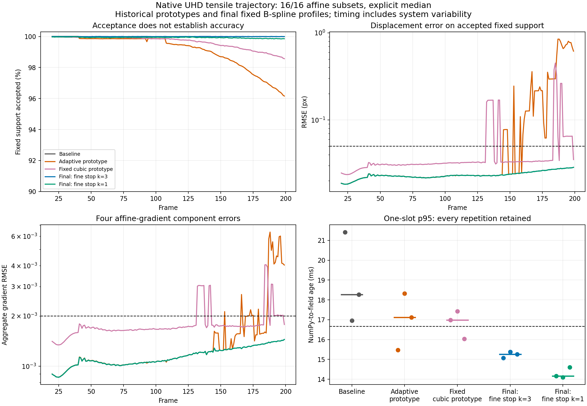

# Native UHD latency reduction — 30 October 2026

**The final fixed B-spline profile passes the declared one-slot latency and accuracy gates in all three final runs.** The conservative setting is preferred: its p95 ages are 15.072, 15.384 and 15.263 ms (pooled p95 15.263 ms), with 77.77 FPS median campaign throughput. Defaults remain unchanged. This is a finite qualification on Intel LNL, not a universal hard real-time guarantee.

## Scope and method

- Native 3840 × 2160, the same archived reference and hash-checked 200-frame tensile trajectory up to stretch 1.1. No tiling, resizing, changed stride, reduced ROI or discarded difficult windows.
- Affine, uniform weights, size/stride 16/16, explicit `median`, fixed reference. Except for explicitly adaptive/interpolation trials, B-spline and both levels run on every target. Caps remain `(8,16)` and the existing tolerances/ZNCC threshold are unchanged.
- All cases include the previously implemented `temporal_fine_correction=True`. Baseline prediction is disabled; subsequent ablations add velocity, stopping, adaptive scaling and cubic sampling cumulatively.
- Resident uint8 NumPy image → materialized NumPy field **and statistics**. Acquisition, image formation, truth scoring, plots and file exports are excluded. FPS and result age are distinct.
- Every phase uses three serial process runs, reversed ordering for repeat 1, requested depths 1 and 2. Warm 20 targets through the actual slots, reset, replay 20 to establish identical history, then time frames 20–199 (180 fields). `preparation_ms` covers `set_reference`; constructor compilation is excluded and not separately timed. All samples are retained. Each timed window is only a few seconds; no long-duration thermal soak was performed.
- Intel Graphics LNL / Vulkan Mesa 25.2.8, Python 3.11.14, NumPy 2.4.6, wgpu-py 0.32.0, Pillow 13.0.0. Performance profile was checked before and after every run. Software versions and adapter properties are recorded in each JSON.
- `criteria.json` was written before inspecting candidate quality. Each timed frame must retain ≥90% of the fixed 26,924-position support, displacement RMSE <0.05 px and p95 error <0.10 px. The existing median-gradient bound 0.002 is conservatively applied throughout this specific trajectory as an additional campaign gate. It is not a universal material-strain uncertainty claim.
- “Gradient/strain-component RMSE” here is the established aggregate error over `[du/dx, du/dy, dv/dx, dv/dy]`. It is not a principal-strain or Von Mises uncertainty estimate.

## Reproduce the cost model first

This table was recorded before implementation, at `583afc0`, with the native UHD archived frame 40, 8 warmups, 60 repeated targets and one slot. `cost-model.json` contains all timings. The wait column is host blocking in `map_sync`, **not** a timestamp measurement of GPU kernels. Single-iteration variants are cost probes, not quality-qualified alternatives.

| Interpolation | Levels | Caps | Total median (ms) | Completion wait median (ms) |
|---|---:|---|---:|---:|
| bspline | 2 | [8, 16] | 13.137 | 11.074 |
| bspline | 2 | [1, 1] | 9.329 | 7.799 |
| bspline | 1 | [1] | 7.125 | 5.967 |
| cubic | 1 | [1] | 4.701 | 3.240 |

These indicative differences reproduce the major prefilter/coarse/solver costs, but are not an additive per-kernel cost decomposition.

```bash
rtk proxy DIC/LucasKanadeICGN/python/.venv/bin/python \
  DIC/LucasKanadeICGN/benchmarks/results/latency-reduction-20261030/reproduce_cost_model.py \
  --output /tmp/cost-model.json
```

## Cumulative ablation and retained negative results

The initial prototype applied stopping at every level. **That prototype is not the final stopping implementation.** Main ablation timings and errors are kept below, with their source snapshots. Adaptive acceptance alone did not establish correctness, and cubic did not become the recommendation. The `cubic-fixed` and `cubic-only` controls isolate interpolation from the failed adaptive policy.

### Initial cumulative prototype

Each FPS/median-age entry is the median of three campaign statistics. p95 and p99 triples are the individual runs in repeat order; pooled p95 combines all 540 ages.

| Setting | Requested slots | FPS | Age median (ms) | p95 r0 / r1 / r2 (ms) | Pooled p95 (ms) | p99 r0 / r1 / r2 (ms) | Quality gate |
|---|---:|---:|---:|---|---:|---|---|
| B-spline baseline | 1 | 63.82 | 15.778 | 21.420 / 16.955 / 18.264 | 19.340 | 21.992 / 17.493 / 19.194 | pass |
| B-spline baseline | 2 | 71.48 | 27.952 | 38.429 / 32.321 / 32.445 | 34.413 | 39.817 / 32.516 / 33.218 | pass |
| + velocity | 1 | 63.88 | 15.877 | 17.162 / 18.772 / 17.691 | 18.142 | 19.108 / 19.463 / 18.211 | pass |
| + velocity | 2 | 71.52 | 27.325 | 28.248 / 33.318 / 35.017 | 33.924 | 28.985 / 34.243 / 36.501 | pass |
| + conservative stopping | 1 | 69.11 | 14.730 | 16.993 / 16.262 / 17.841 | 17.272 | 17.968 / 16.485 / 18.279 | pass |
| + conservative stopping | 2 | 71.85 | 27.593 | 33.483 / 32.955 / 31.751 | 32.750 | 34.869 / 34.523 / 32.523 | pass |
| + adaptive pyramid | 1 | 75.31 | 13.271 | 15.475 / 18.330 / 17.115 | 17.446 | 16.157 / 18.954 / 17.728 | FAIL |
| + adaptive pyramid | 2 | 76.51 | 13.008 | 15.689 / 17.155 / 17.713 | 17.160 | 16.522 / 17.330 / 18.207 | FAIL |
| + cubic / adaptive | 1 | 91.89 | 11.227 | 14.114 / 15.330 / 15.079 | 15.198 | 14.847 / 16.425 / 15.619 | FAIL |
| + cubic / adaptive | 2 | 86.13 | 11.572 | 17.225 / 14.961 / 16.384 | 16.219 | 18.497 / 15.187 / 17.135 | FAIL |

Adaptive runs serialize feedback: requested depth 2 still has **one** image outstanding. They are not two-slot throughput measurements. Fixed runs use the requested depth.

### Fixed-pyramid interpolation control

Each FPS/median-age entry is the median of three campaign statistics. p95 and p99 triples are the individual runs in repeat order; pooled p95 combines all 540 ages.

| Setting | Requested slots | FPS | Age median (ms) | p95 r0 / r1 / r2 (ms) | Pooled p95 (ms) | p99 r0 / r1 / r2 (ms) | Quality gate |
|---|---:|---:|---:|---|---:|---|---|
| + conservative stopping | 1 | 65.42 | 15.345 | 18.333 / 17.993 / 16.831 | 17.947 | 18.745 / 18.849 / 17.232 | pass |
| + conservative stopping | 2 | 71.37 | 27.532 | 32.742 / 33.601 / 30.473 | 32.742 | 33.675 / 34.546 / 31.407 | pass |
| Cubic / fixed + velocity / stopping | 1 | 71.57 | 14.139 | 16.993 / 17.433 / 16.032 | 17.058 | 17.889 / 17.967 / 16.584 | FAIL |
| Cubic / fixed + velocity / stopping | 2 | 81.12 | 24.769 | 28.376 / 29.772 / 28.945 | 29.091 | 29.769 / 30.824 / 30.809 | FAIL |

### Aggressive stopping and interpolation-only control

Each FPS/median-age entry is the median of three campaign statistics. p95 and p99 triples are the individual runs in repeat order; pooled p95 combines all 540 ages.

| Setting | Requested slots | FPS | Age median (ms) | p95 r0 / r1 / r2 (ms) | Pooled p95 (ms) | p99 r0 / r1 / r2 (ms) | Quality gate |
|---|---:|---:|---:|---|---:|---|---|
| + conservative stopping | 1 | 66.14 | 15.721 | 18.392 / 17.593 / 18.046 | 18.120 | 19.175 / 18.233 / 18.883 | pass |
| + conservative stopping | 2 | 72.19 | 27.233 | 32.975 / 31.628 / 32.913 | 32.848 | 34.825 / 33.518 / 34.499 | pass |
| Aggressive stopping | 1 | 70.39 | 14.548 | 12.848 / 16.934 / 16.668 | 16.635 | 13.544 / 17.217 / 17.040 | FAIL |
| Aggressive stopping | 2 | 77.00 | 25.952 | 27.496 / 29.627 / 29.812 | 29.530 | 28.235 / 30.160 / 31.015 | FAIL |
| Cubic alone | 1 | 75.92 | 13.508 | 16.429 / 14.733 / 17.097 | 16.435 | 17.479 / 15.568 / 17.757 | FAIL |
| Cubic alone | 2 | 91.98 | 22.014 | 24.717 / 25.545 / 31.459 | 29.217 | 25.293 / 26.141 / 32.822 | FAIL |

### Exact counter aggregation control

Each FPS/median-age entry is the median of three campaign statistics. p95 and p99 triples are the individual runs in repeat order; pooled p95 combines all 540 ages.

| Setting | Requested slots | FPS | Age median (ms) | p95 r0 / r1 / r2 (ms) | Pooled p95 (ms) | p99 r0 / r1 / r2 (ms) | Quality gate |
|---|---:|---:|---:|---|---:|---|---|
| Global counters | 1 | 65.62 | 15.454 | 17.734 / 17.881 / 17.996 | 17.926 | 18.639 / 18.543 / 18.523 | pass |
| Global counters | 2 | 71.66 | 27.598 | 32.988 / 33.722 / 31.968 | 32.987 | 34.118 / 35.067 / 33.227 | pass |
| Grouped counters | 1 | 65.90 | 15.328 | 18.688 / 12.823 / 17.783 | 17.833 | 19.933 / 13.218 / 18.715 | pass |
| Grouped counters | 2 | 91.13 | 22.014 | 24.199 / 24.413 / 31.473 | 30.160 | 24.473 / 25.075 / 33.063 | pass |

All quality rows, counters and 18 final-array comparisons match bit for bit. Counter aggregation reduces global atomic operations but this isolated campaign does **not** demonstrate a reproducible one-slot speedup; retain that uncertainty when interpreting the final profile.

### Final finest-only stopping control

Each FPS/median-age entry is the median of three campaign statistics. p95 and p99 triples are the individual runs in repeat order; pooled p95 combines all 540 ages.

| Setting | Requested slots | FPS | Age median (ms) | p95 r0 / r1 / r2 (ms) | Pooled p95 (ms) | p99 r0 / r1 / r2 (ms) | Quality gate |
|---|---:|---:|---:|---|---:|---|---|
| + conservative stopping | 1 | 77.77 | 12.759 | 15.072 / 15.384 / 15.263 | 15.263 | 15.721 / 16.007 / 15.502 | pass |
| + conservative stopping | 2 | 84.75 | 23.615 | 27.044 / 27.124 / 27.098 | 27.113 | 28.403 / 28.383 / 27.538 | pass |
| Aggressive stopping | 1 | 81.05 | 12.095 | 14.165 / 14.102 / 14.601 | 14.282 | 14.415 / 14.369 / 15.392 | pass |
| Aggressive stopping | 2 | 88.61 | 22.398 | 24.075 / 24.732 / 24.493 | 24.483 | 24.588 / 25.665 / 24.852 | pass |

## Numerical quality, all windows and stopping cost

Fine/coarse iteration means below include **all grid positions**, not just accepted ones. Coarse means include zero work on adaptive fine-only frames. Diagnostics run in a separate untimed replay. The late-convergence audit reruns the exact retained seed and image without stopping, after history was merged, without modifying that history. These extra solves/readbacks never occur in production or inside the timed stream. Counts are window-frame events over 180 frames, not distinct spatial windows.

| Phase / setting (depth 1) | Worst fixed coverage | Worst fixed displacement RMSE (px) | Worst fixed gradient RMSE | Mean fine / coarse iterations, all windows | Late status-1 events lost: all / fixed | Last whole-grid coverage / displacement RMSE (px) |
|---|---:|---:|---:|---|---|---|
| runs / B-spline baseline | 99.9851% | 0.028577 | 0.001446 | 2.6766 / 2.8019 | 0 / 0 | 89.994% / 2.5814 |
| runs / + velocity | 99.9851% | 0.028578 | 0.001446 | 2.6761 / 2.0077 | 0 / 0 | 89.985% / 2.5816 |
| runs / + conservative stopping | 99.9851% | 0.028577 | 0.001446 | 2.5786 / 2.0078 | 51 / 0 | 89.981% / 2.0420 |
| runs / + adaptive pyramid | 96.1596% | 0.847609 | 0.006357 | 2.6845 / 1.0789 | 960 / 875 | 86.725% / 2.4833 |
| runs / + cubic / adaptive | 96.7724% | 0.497873 | 0.003305 | 2.9306 / 1.6701 | 1222 / 1111 | 87.194% / 1.4509 |
| interpolation-control / + conservative stopping | 99.9851% | 0.028577 | 0.001446 | 2.5786 / 2.0078 | 51 / 0 | 89.981% / 2.0420 |
| interpolation-control / Cubic / fixed + velocity / stopping | 98.5700% | 0.450162 | 0.004049 | 3.0546 / 3.2053 | 559 / 461 | 88.716% / 2.0065 |
| followup-control / + conservative stopping | 99.9851% | 0.028577 | 0.001446 | 2.5786 / 2.0078 | 51 / 0 | 89.981% / 2.0420 |
| followup-control / Aggressive stopping | 99.1049% | 0.135488 | 0.002432 | 2.3329 / 2.0002 | 4343 / 2734 | 89.151% / 1.6260 |
| followup-control / Cubic alone | 98.6518% | 0.327570 | 0.003903 | 3.1729 / 4.2809 | 0 / 0 | 88.821% / 2.0808 |
| counter-control / Global counters | 99.9851% | 0.028577 | 0.001446 | 2.5786 / 2.0078 | 51 / 0 | 89.981% / 2.0420 |
| counter-control / Grouped counters | 99.9851% | 0.028577 | 0.001446 | 2.5786 / 2.0078 | 51 / 0 | 89.981% / 2.0420 |
| finest-only-control / + conservative stopping | 99.9851% | 0.028578 | 0.001446 | 2.5793 / 2.0080 | 46 / 0 | 89.991% / 2.5815 |
| finest-only-control / Aggressive stopping | 99.8477% | 0.028562 | 0.001446 | 2.3282 / 2.0022 | 3109 / 2011 | 89.867% / 1.7762 |

Whole-grid errors near the deformed/reflected image boundaries persist. For the final conservative setting the last own-population RMSE is about **2.58 px**, versus **0.02858 px** on the fixed interior support. Those failures are not relabeled as accurate measurements or removed from runtime. The complete per-frame own/fixed coverage, errors, rejection counts and iteration distributions remain in the JSON reports.

## Why the final profile keeps complete coarse solves

Velocity substantially reduces coarse iterations (2.802 → about 2.008 over all positions) but barely changes fine iterations by itself. It predicts the fine history **before projection to the coarsest grid**; a complete coarse solve still supplies the fine correction.

The all-level aggressive prototype reached 0.1355 px worst fixed-support RMSE. A premature coarse stop can provide a bad seed to several fine windows and change later temporal history. The final implementation therefore applies stagnation stopping **only to the finest solve**, preserving full coarse caps/tolerances. A GPU test verifies that coarse states remain bit-for-bit equal to no-abort states on the same image.

The final conservative setting (`patience=3`, minimum 4) passes both gates in three runs. Its worst fixed coverage is 99.9851%, worst displacement RMSE 0.028578 px, p95 error 0.053065 px and gradient RMSE 0.001446. The same-seed audit counts **46** late status-1 events outside the fixed support and **zero inside it**. All 180 coarse solves run.

The final aggressive setting (`patience=1`, minimum 2) also passes the declared gates and is faster, but loses **2,011** potential late convergences inside the fixed support. Its worst fixed coverage is 99.8477%. Prefer the conservative setting unless that extra loss is acceptable and separately qualified for the application.



## Qualified opt-in configuration

```python
with ICGNWGPUFullPyramid(
    initialization="temporal",
    temporal_prediction="velocity",
    temporal_fine_correction=True,
    divergence_patience=3,
    divergence_min_iterations=4,
    pyramid_policy="fixed",
    pyramid_levels=2,
    interpolation="bspline",
    motion_model="affine",
    subset_size=16, subset_stride=16,
    outlier_policy="median",
    device_type="gpu",
) as engine:
    engine.set_reference(reference)
    for result in engine.register_stream(ordered_frames, pipeline_depth=1):
        consume(result)
```

Defaults remain zero initialization, no prediction, no stopping and a fixed pyramid. No reference update, displacement accumulation, parameter loss, changed tolerance or reduced iteration cap is hidden in this profile. History stores measurements, never predictions. Reset, expiry and corruption fallbacks are covered by tests. Both reference ROI policies remain supported; this timing qualification itself uses no ROI.

## Reproduce the final campaign

Generate the same hash-checked cache with `benchmark_realtime_optimization.py --prepare-cache` if it is absent. This consumes about 1.66 GB and never runs the historical fixture generator. Do not run builds, tests, plots or scoring concurrently with timed processes.

```bash
rtk proxy DIC/LucasKanadeICGN/python/.venv/bin/python \
  DIC/LucasKanadeICGN/benchmarks/benchmark_latency_reduction.py \
  --campaign --variants abort abort-fast \
  --target-cache /tmp/live-dic-rt-trajectory.npy \
  --output /tmp/finest-only-control

rtk proxy DIC/LucasKanadeICGN/python/.venv/bin/python \
  DIC/LucasKanadeICGN/benchmarks/results/latency-reduction-20261030/summarize.py
```

The summarizer expects the archived directory layout. `summary.json` contains all individual statistics, pooled quantiles and predeclared gate decisions. `plot_results.py` recreates the PNG/PDF. `verify_default_parity.py` compares 30 pre-change arrays, including native UHD frame 40.

## Source provenance and limitations

| Collection | Runtime snapshot |
|---|---|
| Initial baseline | `583afc0` |
| Initial ablation candidates | `27e7b0c` (runtime introduced in `ca80bba`) |
| Fixed interpolation control | `1eb2d8a` |
| Aggressive / interpolation-only control | `d503d2e` |
| Counter control | old `d503d2e`, new `0cb620c` |
| Final finest-only control | `15e6e1c` |

Historical prototype commands must load their recorded source snapshot, not current `main`. Use a detached worktree and set `PYTHONPATH` to its `DIC/LucasKanadeICGN/python/src` while using the same interpreter and benchmark script. For the initial phase, use `--variants baseline velocity abort adaptive cubic`; fixed-interpolation controls use `--variants abort cubic-fixed`; follow-up controls use `--variants abort abort-fast cubic-only`. All constructor options, commands, source hashes and input hashes are saved per run.

`git_dirty` is recorded honestly: uncommitted reports/documentation existed during measurement. The four runtime file hashes identify the code actually loaded. Effective solver configuration was subsequently copied from each original NPZ into the corresponding JSON; timing and quality samples were not changed. NPZ archives remain readable with `allow_pickle=False`.

No CPU-heavy validation was launched during timed processes, but desktop services were not isolated. A post-counter-campaign sample found `cupsd` at about 99% of one CPU core, alongside browser/display activity (`post-run-load.json`). This was **not** sampled per frame or during the final campaign, and does not establish causation. No system printing/browser service was stopped. The isolated counter trial already shows that large timing variations cannot be assigned to one kernel change with confidence.

The result is therefore: **the final fixed B-spline profile passes the requested finite three-run qualification; a hard deadline under arbitrary system load is not established.** The initial adaptive prototype fails numerical gates. A numerical-only replay of the final runtime still rejects adaptive mode (0.873921 px worst displacement RMSE) and cubic alone (0.327570 px); `current-rejected-policy-check.json` keeps every quality row without a new timing claim. Cubic-alone and fixed-cubic controls also fail the displacement/gradient gates, so B-spline remains the recommendation. Software Vulkan validates correctness, not these hardware timings.

`validation.json` records actual local checks, wheel installation outside the checkout and the browser shared-WGSL control. No new remote CI result is claimed and nothing was pushed.
