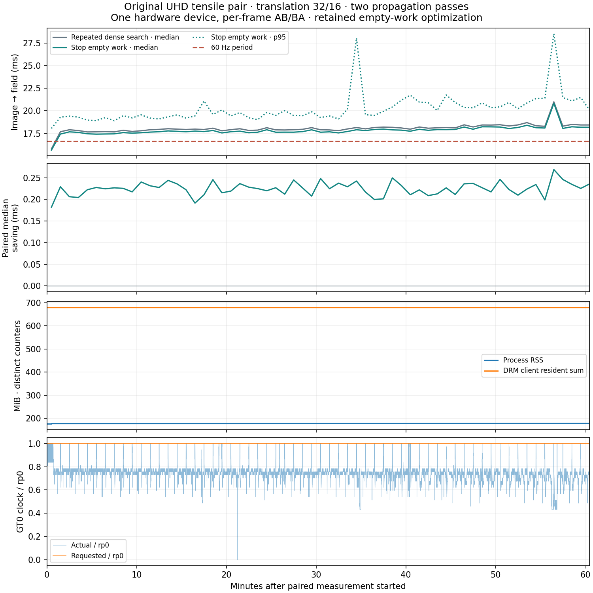

# Monitored UHD propagation soak — 2026-11-04

The retained empty-work optimization saves a small amount of time without changing
checked fields. **This sustained case does not meet 60 fields/s.** Memory remains
bounded over the observed hour; this is neither a camera-to-disk campaign nor an
all-device qualification.

Clean measured source: `99ca6fdfde27db83a6cefa0fa06a73290318df66`.
Original archived 3840 × 2160 tensile reference/frame 40, translation 32/16,
B-spline, uniform integration, two fixed levels (8/16 iterations), tolerance
0.005, ZNCC 0.8, no ROI, raw final fields, one synchronous slot. Both variants
have two failed-only propagation passes per level. Only the candidate stops
subsequent searches when a pass produces no new work. No score cache or fused
rejection collector is enabled.

Intel LNL integrated GPU, Vulkan, Mesa 25.2.8, wgpu-py 0.32.0. The recorded power
profile and EPP are `performance`; the Intel pstate governor reports `powersave`.
One prepared device alternates AB/BA after each pair. No project test, build or
other project GPU campaign ran concurrently. An explicitly recorded, asynchronous
5 Hz Linux observer sampled this process and system sensors; sampling can itself
perturb scheduling and power. Unrelated desktop processes were not controlled.

The boundary is **resident NumPy target → materialized field and statistics**.
Preparation, decoding, display, durable field recording and diagnostic logging
are excluded from individual call durations. The observed combined rate below
includes alternation and logging overhead. The same target is repeated; temporal
frame association, physical camera capture and long-result storage are not tested.

| Variant | Median | p95 | p99 | Fields / sum of call durations |
|---|---:|---:|---:|---:|
| Repeat dense searches | 18.010 ms | 20.627 ms | 23.437 ms | 54.829/s |
| Stop empty work | 17.776 ms | 20.392 ms | 23.202 ms | 55.541/s |

100,031 pairs, **200,062 registrations in 3,628.514 s**. The median per-pair
saving is 0.22573 ms. The combined observed rate is 55.136 fields/s.
94.12% of candidate calls exceed 16.67 ms. These are serial engine results,
so call latency is relevant; a pipeline throughput figure would be a different
measurement. This soak did not establish a new repeatability margin; the
separate predeclared paired acceptance experiment is in
[`../propagation-empty-work-20261104/`](../propagation-empty-work-20261104/).
Do not substitute this hour's absolute values for earlier short-campaign numbers.

All 97 periodic complete parameter/status/iteration comparisons are exact;
acceptance is checked on every call. There are 31,284 accepted grid positions
in each result. The separately defined 30,916-centre analytical interior retains
100% coverage, vector RMSE 0.0101684 px and p95 error 0.0172276 px. Raw fields
are not stored for every repetition. This easy pair queues no additional solves;
it does not qualify robustness or speed on an actively changing difficult field.

During measurement, 18,133 observer samples report process RSS between
175.30 and 177.36 MiB. Requested and resident DRM client sums each remain exactly
712,192,000 bytes. These counters describe distinct, potentially shared backing;
they are not physical/free VRAM and must not be added to RSS. No runaway growth
is observed during this run; it is not a proof against every possible leak.

Requested GT0 frequency stays at the recorded raw value 1850; actual frequency
varies (median 1400). The plot normalizes both by the reported `rp0` value rather
than guessing units. PL4 is asserted in 2.23% of samples and the sampled thermal
flag stays zero. Package-temperature samples range from 57 to 97 °C. These are
observations, not an isolated causal explanation of timing drift. Short limit
events can escape asynchronous sampling. Consult the
[kernel DRM accounting contract](https://docs.kernel.org/gpu/drm-usage-stats.html)
and [Xe frequency contract](https://docs.kernel.org/gpu/xe/xe_gt_freq.html).

Checkpoint stage wall timers put the dominant wait around command completion
and result return. They overlap and are last-pair snapshots, not GPU timestamps
or distributions for individual kernels. A timestamp-qualified attribution is
still needed before naming a particular kernel as the cause of the remaining
60 Hz gap.



`report.json` retains the exact command, source revision, versions, configuration,
input/source hashes, all checkpoints and quality. `timings.npz` contains all
100,031 `[pairElapsedMs, controlMs, candidateMs]` rows and loads without pickle.
`monitor.json`, `monitor.csv.gz` and `drm.jsonl.gz` retain observer identity,
raw sensors and deduplicatable client records. `analysis.json` contains simple
summary statistics and ten-minute bins. `sources.tar.gz` holds the measured
benchmark/shader/observer sources. `plot.py` regenerates the standalone figure
with NumPy and Matplotlib; these are offline report tools, not new runtime
dependencies. `sha256.json` authenticates the archived artifacts.

Example reproduction from a checkout of the measured source, after installation:

```bash
PYTHONPATH=DIC/LucasKanadeICGN/python/src \
  DIC/LucasKanadeICGN/python/.venv/bin/python \
  DIC/LucasKanadeICGN/benchmarks/benchmark_spatial_soak.py \
  --duration-seconds 3600 --checkpoint-pairs 1024 --output /tmp/live-dic-soak
```

Run the optional observer in another terminal with that benchmark's process ID:

```bash
python3 DIC/LucasKanadeICGN/benchmarks/monitor_linux_process.py \
  --pid BENCHMARK_PID --max-seconds 5000 --output /tmp/live-dic-soak-monitor
```

Use new output directories and preserve the same measurement boundary. The
archived run used the absolute UTC deadline recorded in `report.json`, which
accounts for its slightly greater than one-hour duration. No fixture was
regenerated, no private images were archived and no numerical gate was relaxed.
