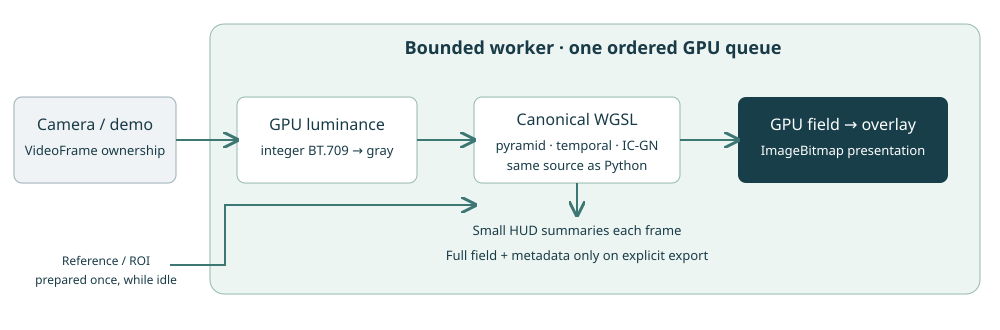

Portable browser engine and resource budget
===========================================

The browser front-end uses the canonical WGSL sources packaged with Python.
The JavaScript host is separated from the Python binary-transport shim;
the equations must not acquire a second browser implementation.

Phase 0: binding audit (pre-change b9d23a2)
-------------------------------------------

WebGPU's core guaranteed limits include eight storage buffers per shader stage,
four bind groups, 128 MiB per storage binding, a 256 MiB maximum buffer,
256 invocations per workgroup, 16 KiB workgroup storage and 8192 pixels per
texture dimension. Check actual adapter limits before constructing resources.
See the `WebGPU limits specification <https://www.w3.org/TR/webgpu/#limits>`_.
Limits count the entire explicit pipeline layout, including unused bindings,
across all groups visible to the stage, not just expressions executed by a
particular shader entry point.

.. list-table:: Existing compute pipeline layouts before packing
   :header-rows: 1

   * - Pipeline family
     - Storage buffers
     - Uniforms
     - Sampled / storage textures
     - Bind group slots
   * - IC-GN, FIR, median, native subgroup (shared base layout)
     - 8
     - 1
     - 1 / 0
     - 1
   * - Seeded IC-GN / retry / partial
     - **10**
     - 1
     - 1 / 0
     - 1
   * - Separable or fused image reduction
     - 0
     - 0
     - 1 / 1
     - 1 or 2
   * - Coarse-to-fine seed transfer
     - 3 (4 with ROI links)
     - 1
     - 0 / 0
     - 3
   * - Temporal projection / merge
     - 5
     - 1
     - 0 / 0
     - 3 / 4
   * - Velocity prediction / previous-state save
     - 6
     - 0 / 1
     - 0 / 0
     - 3 / 4
   * - Fine temporal correction
     - 7
     - 2
     - 0 / 0
     - 3

The temporal entry points use separate layouts: group 2 and group 3 are not
both declared in the same temporal pipeline layout. Empty preceding groups
consume group slots, but add no buffer bindings. Counting their module-wide
declarations together would overstate the actual pipeline requirement.

.. list-table:: Default 16/16 grid resource sizes
   :header-rows: 1

   * - Input
     - Grid
     - Reference vec4 buffer
     - Two float32 FIR planes
   * - 1280 x 720
     - 80 x 45
     - 14,745,600 bytes
     - 7,372,800 bytes
   * - 1920 x 1080
     - 120 x 67
     - 33,177,600 bytes
     - 16,588,800 bytes
   * - 3840 x 2160
     - 240 x 135
     - 132,710,400 bytes
     - 66,355,200 bytes

UHD fits a 128 MiB binding for the reference alone, but appending its inverse
Hessians and metadata would exceed that guaranteed limit. The chosen packing
therefore combines the two FIR scratch planes and combines metadata with
inverse Hessians, leaving the large reference separate. This reduces the
base layout from eight to six storage bindings and seeded solving from ten
to eight, without adding a copy, dispatch or floating-point operation.
The group indices, temporal mathematics and partial-support payload remain
unchanged. Qualification results are recorded with the implementation.

Static buffer limits do not prove that a device has enough memory to run UHD.
Capability checks must also account for all levels, reference preparation,
mutable slots and history buffers. Mobile devices are not assumed tested.

Shared packing qualification
----------------------------

The packed layout requests eight storage buffers explicitly. The ordinary
solver/FIR/median layout uses six; the seeded layout uses eight. Metadata and
inverse Hessians share a buffer, with a vec4 offset in the 48-byte configuration.
FIR coefficients occupy the first scratch plane and intermediate values the
second. Prefilters bind both planes; solvers bind only the first, preserving
historical array bounds even for divergent quadratic warps.

The recorded UHD comparison verifies **441 arrays bit for bit across 49
configurations**, including partial ROI and rejected results. Hardware A/B pairs
showed no regression outside the predeclared repeatability margin. Quality
reports were identical. See the reproducible
`binding-budget report <https://github.com/jeffwitz/live-dic/tree/main/DIC/LucasKanadeICGN/benchmarks/results/binding-budget-20261031>`_.
These are native NumPy-to-NumPy measurements, not browser camera timings.

Three layers, one solver source
-------------------------------

``web/core`` is a dependency-free ES-module library. ``web-app`` owns camera
permissions, controls, worker admission, rendering and downloads. The Python
``webgpu-wgsl`` page is a thin compatibility shim around that same core;
BinaryTransport remains outside it. Three.js/TSL and historical GPU-IO are
separate backends and are not dependencies of the application.

An engineer can think of a shader as a function run many times on the GPU.
The CPU host prepares arrays and records the ordered calls. The solver
workgroup cooperatively processes a subset: with 16 lanes and 256 pixels,
each lane handles 16 pixels before sums are reduced. This is distinct from
a 256-lane FIR/input/median workgroup and from the number of frames in flight.
See :doc:`webgpu-fundamentals` for the underlying vocabulary.

Only the host was ported. ``icgn.wgsl`` owns the IC-GN equations, model updates,
convergence and spatial policies. ``full_pyramid.wgsl`` owns reduction, seed
transfer and temporal equations. ``input.wgsl`` converts colour and
``result.wgsl`` computes diagnostic summaries; neither rewrites LK.
``reference.js`` is the cold CPU preparation, moved from the common browser
helper; Python retains its NumPy preparation. Floating-point preparation and
backend lowering can differ, so sharing WGSL is not a promise of bit-identical
JavaScript/Python fields. The cross-runtime tests report these differences.

Input without a pixel round trip
--------------------------------

A transferred VideoFrame/ImageBitmap retains browser-managed image ownership.
``copyExternalImageToTexture`` copies its colour image to a GPU texture.
The luminance kernel first recovers the three uint8 channel values, then uses

.. code-block:: text

   gray = floor((2126*R + 7152*G + 722*B + 5000) / 10000)

This is BT.709 rounding to nearest byte with ties upward. The integer numerator
avoids ambiguous floating-point half-byte rounding. The storage output is
``rgba8unorm`` with the same gray byte in RGB; the solver reads its red channel,
just as it reads an ``r8unorm`` NumPy upload. The kernel is tested against an
independent CPU integer formula, including odd dimensions.

The hot external-image path never constructs a JavaScript CPU pixel image or
reads target pixels back. The cold reference reads luminance once for reference
preparation. A Uint8Array still uploads directly through the original r8 path.
The Python compatibility shim retains its existing monochrome reference
convention. RGB camera luminance is explicit and should not be assumed equal
to Pillow's different RGB-to-L conversion.

This does not certify hardware decoding or zero-copy acquisition. Browsers and
drivers may stage or copy external images internally. Transfers of browser
image objects avoid an application-level pixel serialization; they are not
cross-process shared NumPy memory.

Slots, history and presentation
-------------------------------

Reference buffers, metadata, Hessians, static ROI links and uniform schedules
are shared. Every admitted frame has separate target textures, FIR scratch,
state, seed/activity buffers, counters and mapped readback. These resources and
pipelines are prepared before the sequence. A full ring rejects new admission;
the application drops and closes the incoming frame rather than growing a
promise queue.

Submission n updates the shared history before submission n+1 reads it through
the ordered GPU queue. Velocity uses accepted raw history, never predicted or
median-smoothed output as its own observation. Fine correction and age-matched
stencils use the canonical temporal entry points. Only the finest solve has
stagnation stopping. Every configured fixed-pyramid level runs on every frame.
Reset and reference replacement wait for pending work.

The renderer reads ``fieldBuffer`` on that device. It renders into an
OffscreenCanvas in the worker and transfers an ImageBitmap for main-thread
presentation, without CPU field readback. This also avoids a headless Vulkan
surface-presentation limitation observed in the local harness. A platform
without OffscreenCanvas uses the same session and GPU renderer on the main
thread; that fallback is implemented but is not part of the local worker
performance qualification.

GPU-only display returns small per-workgroup sums/maxima and temporal counters
for the HUD. This is a small-readback path, not a zero-byte claim. Full export
is explicit and measured separately. See :doc:`../reference/js-api` for typed
full/decimated results and lifetime rules.

ROI and resource limits
-----------------------

Full ROI uses the native selection, reflected five-tap mask reduction and
closed-box neighbour/seed permissions. Geometry and hashes are prepared in
reference coordinates once. A fine selected point remains active without a
coarse seed and falls back to zero. Empty masks produce exclusions, not failed
correlations. Full/partial supports must not be conflated: partial and
truncation are explicitly unavailable in the browser. Gaussian integration is
also native-only. The full-policy preprocessing scope is explained once in
:doc:`../how-to/use-roi`.

The audit table counts binding limits per actual pipeline layout. It does not
measure total memory. UHD uses almost the guaranteed 128 MiB for the reference
alone; input colour/gray textures, scratch, histories, slots and cold CPU
preparation add substantial memory. The formal limits can fit while allocation
fails on a mobile device. Do not copy every advertised adapter limit into a
device request or infer an optimal workgroup width from a vendor name.

``probeCapabilities`` combines checked limits with a short on-device graph
benchmark. It tries only fitting resolutions, keeps raw samples and reports
its recommendation and reasons. A static zero-motion benchmark is advisory;
thermal throttling, motion, video decoding and display require longer runs.
No subgroup feature is required. Minimal/adaptive/cubic trajectory shortcuts
are not promoted after failed or missing native gates.

Static distribution and offline coherence
-----------------------------------------

The assembler copies core and canonical WGSL to a static tree, checks shader
and demo hashes, and embeds the source revision in the service-worker version.
The site uses relative module URLs, including when hosted under ``/live-dic/``.
The CSP permits same-origin scripts and prohibits inline scripts/eval. There
are no CDN, analytics, SharedArrayBuffer or COOP/COEP requirements.

The service worker caches shell, modules, shaders and demonstration data,
including range responses from its cached video. Cache namespaces include the
site scope. New workers wait for old clients to finish before activation;
old caches are removed at activation. Dirty local builds add a content digest
to the commit-derived version. The app can run offline after a successful first
installation, subject to browser storage quotas.

Qualification scope and device matrix
-------------------------------------

Native layout parity, hardware/CPU browser parity, UHD ROI and demo reports
are linked from :ref:`browser-core-qualification`. Tolerances were declared
before the temporal comparisons; complete frame rows retain all status,
iteration and parameter differences. No tolerance was relaxed to pass the port.
The original lossless UHD fixtures remain unchanged.

.. list-table:: Actual coverage, not inferred device support
   :header-rows: 1

   * - Platform/browser
     - Execution
     - Qualification scope
   * - Desktop Linux Chromium, Intel Lunar Lake Vulkan
     - Local headless browser, dedicated worker and GPU display snapshot
     - Core parity, UHD fixtures, demo. Camera hardware and interactive capture not qualified.
   * - Desktop Linux Chromium, SwiftShader
     - Local software WebGPU
     - Core/input/ROI tests and demo smoke. Software times do not qualify live GPU performance.
   * - Native Linux lavapipe
     - CPU Vulkan adapter
     - Software reference for cross-runtime correctness, not hardware timing.
   * - Android Chrome
     - Untested
     - No device/browser/adapter/FPS evidence.
   * - iOS/iPadOS Safari
     - Untested
     - No device/browser/adapter/FPS evidence.
   * - Desktop Safari
     - Untested
     - No Metal/browser-camera qualification.
   * - Firefox
     - Untested
     - No browser WebGPU execution evidence for this application.

Portable OS CI and the prepared browser-software CI job do not certify those
untested devices. Camera locks, optics, rolling shutter and hand-held motion
remain separate metrology questions.
