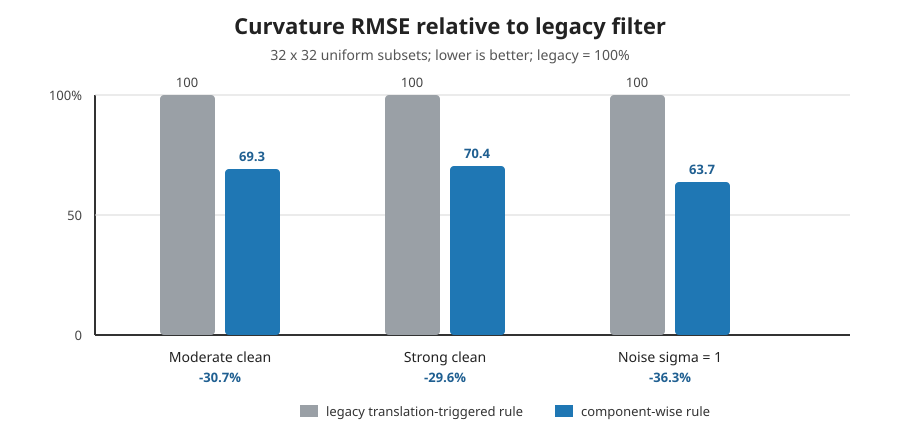

Component-wise median replacement
=================================

The component-wise normalized median replacement is an experimental DIC-RT
contribution. It extends the normalized median test from displacement vectors
to the coefficients of a local affine or quadratic displacement polynomial.
Each coefficient is validated and, when necessary, replaced independently.

This distinction is important. A subset can contain a reliable translation
and first derivative but one unstable curvature coefficient. Replacing its
complete polynomial discards useful information. Testing only the translation,
on the other hand, leaves the unstable curvature untouched. The DIC-RT rule
keeps the coherent coefficients and replaces only the local outliers.

.. important:: Literature position

   A targeted search performed on 29 October 2026 found established normalized
   median tests for PIV displacement vectors, second-order DIC shape functions,
   and robust post-processing of DIC/DVC displacement fields. It did not find a
   published method combining all four properties used here: recentering local
   polynomial shape functions, testing every affine and quadratic coefficient
   independently, using coefficient-specific physical floors, and replacing
   only the flagged coefficients.

   This bounded search is evidence that the formulation is unusual; it is not
   a formal proof of novelty. A broader systematic literature review would be
   required before making a priority claim in a publication.

Why translation-only validation is insufficient
------------------------------------------------

The former implementation computed neighbour medians for all coefficients but
used only the two subset-centre translations to decide whether a result was an
outlier. When either translation was flagged, the complete affine or quadratic
state was replaced. Consequently:

* an isolated bad curvature could survive when translation was plausible;
* one bad translation could erase otherwise plausible gradients and
  curvatures;
* the decision threshold had pixel units and could not be applied directly to
  dimensionless gradients or inverse-pixel curvatures.

The new pass treats the affine or quadratic polynomial as six or twelve
related measurements rather than one indivisible record.

Algorithm
---------

For every accepted subset :math:`s`, the direct 3 by 3 neighbourhood provides
up to eight accepted neighbours :math:`n`. Each neighbour polynomial is first
recentered from its own subset centre to the centre of :math:`s`. This produces
comparable coefficients :math:`\widetilde p_{n\rightarrow s,k}` for component
:math:`k`.

.. code-block:: text

   accepted direct neighbours
              |
              v
   recenter every neighbour polynomial
   at the current subset centre
              |
              v
   for each coefficient independently
      median + median absolute deviation
              |
              v
   normalized residual > 2 ?
        |                 |
       yes                no
        |                 |
   replace only k      retain k
        \_________________/
                  |
        status 2 if any k changed

For one component, the neighbour median and robust local spread are

.. math::

   m_{s,k} &= \operatorname{median}_{n}
              \left(\widetilde p_{n\rightarrow s,k}\right),\\
   d_{s,k} &= \operatorname{median}_{n}
              \left|\widetilde p_{n\rightarrow s,k}-m_{s,k}\right|.

The normalized residual is

.. math::

   r_{s,k} = \frac{|p_{s,k}-m_{s,k}|}{d_{s,k}+\epsilon_k}.

Only component :math:`k` is replaced when :math:`r_{s,k}>2`. At least four
accepted neighbours are required. Otherwise the subset is left unchanged.
Status 2 means that at least one coefficient was replaced; it does not imply
that the complete polynomial was replaced.

Selecting the filtered coefficients
-----------------------------------

The filter scope is fixed when the engine is constructed. Two choices are
available on every backend:

.. code-block:: python

   # Default: test and replace every active polynomial coefficient.
   engine = ICGNWGPUFullPyramid(median_scope="all")

   # Test and replace tx and ty only; preserve every derivative coefficient.
   engine = ICGNWGPUFullPyramid(median_scope="displacement")

``median_scope="displacement"`` still recentres each neighbouring affine or
quadratic polynomial before computing the two centre-displacement medians.
If :math:`t_x` is an outlier, only :math:`t_x` is replaced; :math:`t_y`, all
gradients, and all curvatures are retained. ``median_scope="all"`` applies the
same independent decision to every active coefficient and remains the default.

For ``motion_model="translation"`` the two scopes are numerically equivalent
because :math:`t_x` and :math:`t_y` are the only active coefficients. The
selected value is reported as ``medianScope`` in reference and registration
configuration dictionaries. Changing it requires constructing the intended
engine configuration and preparing the reference for that engine.

Unit-aware robustness floors
----------------------------

A single additive floor cannot serve translations, gradients, and curvatures
because their units differ. DIC-RT expresses every floor as its displacement
effect at the subset edge. Let :math:`h=(S-1)/2` be the half extent of a subset
of width :math:`S`:

.. list-table:: Robustness floors
   :header-rows: 1

   * - Components
     - Coefficient floor :math:`\epsilon_k`
     - Edge-displacement interpretation
   * - :math:`t_x,t_y`
     - :math:`0.1` px
     - historical normalized-median noise floor
   * - affine gradients
     - :math:`0.001/h`
     - 0.001 px at the subset edge
   * - pure curvatures :math:`u_{xx},u_{yy},v_{xx},v_{yy}`
     - :math:`0.001/(h^2/2)`
     - 0.001 px from the corresponding half-square basis term
   * - cross curvatures :math:`u_{xy},v_{xy}`
     - :math:`0.001/h^2`
     - 0.001 px from the cross term

The 0.1-pixel translation floor and threshold 2 follow the normalized median
test convention. The 0.001-pixel derivative effect is a DIC-RT engineering
choice and must be qualified for the intended images and metrology.

Measured curvature result
-------------------------

The comparison below uses exactly the same analytic image generator, GPU, and
current implementation. The only changed setting is ``median_scope``:

* ``displacement``: independently validate and replace only :math:`t_x` and
  :math:`t_y`;
* ``all``: independently validate and replace all twelve quadratic
  coefficients;
* 768 x 768 continuous analytic texture rasterized to 8-bit grayscale;
* 32 x 32 uniform subsets, stride 16, B-spline interpolation;
* eight measured registrations after three warm-ups;
* exact second-order displacement truth evaluated at every subset centre.

.. list-table:: Analytic A/B result for the 32 x 32 uniform subset
   :header-rows: 1

   * - Field and image condition
     - ``displacement``
     - ``all``
     - Relative change
   * - Displacement RMSE, moderate clean (px)
     - 0.00623126
     - 0.00623133
     - unchanged (<0.01%)
   * - Gradient RMSE, moderate clean
     - 5.729e-4
     - 6.494e-4
     - **+13.3%**
   * - Curvature RMSE/component, moderate clean
     - 5.727e-5
     - **3.970e-5**
     - **-30.7%**
   * - Displacement RMSE, strong clean (px)
     - 0.00679760
     - 0.00679397
     - -0.05%
   * - Gradient RMSE, strong clean
     - 6.390e-4
     - 7.702e-4
     - **+20.5%**
   * - Curvature RMSE/component, strong clean
     - 6.428e-5
     - **4.525e-5**
     - **-29.6%**
   * - Displacement RMSE, noise :math:`\sigma=1` gray level (px)
     - 0.02244174
     - 0.02244163
     - unchanged (<0.01%)
   * - Gradient RMSE, noise :math:`\sigma=1` gray level
     - 2.046e-3
     - 2.309e-3
     - **+12.9%**
   * - Curvature RMSE/component, noise :math:`\sigma=1` gray level
     - 1.981e-4
     - **1.263e-4**
     - **-36.3%**

The accepted fraction is identical before and after the change in all three
cases. Displacement accuracy is also effectively unchanged. The important
result is therefore specific and reproducible: independent coefficient
replacement reduces curvature RMSE by approximately 30--36%, with the largest
gain in the noisy case. The measured cost is a 13--21% increase in gradient
RMSE. This is not a universal smoothing improvement and the gradient trade-off
must remain visible when the method is reported.

Runtime cost
------------

``displacement`` specializes the shared WGSL median pass to two components;
``all`` evaluates six affine or twelve quadratic components. The saving is
small relative to the complete image-to-field graph. In the UHD affine check
on the validation machine (five campaigns, 20 frames each), the complete
single-slot medians were 11.62 ms for ``displacement`` and 11.49 ms for
``all``. Their campaign ranges overlapped, so this check does not establish a
significant end-to-end speed difference. Select the scope for its metrological
behaviour, not for a claimed frame-rate gain. Both remain below the 16.667 ms
period of 60 FPS on this machine.

Browser-supervised calls have additional transport and synchronization noise.
See :doc:`../reference/performance` for the qualified default ``all``
measurements.

Backend coverage
----------------

The complete twelve-component rule is in the canonical WGSL used by native
wgpu-py and raw browser WebGPU. The six-component affine rule is also
implemented in Three.js/TSL and the deprecated GPU-IO compatibility backend.
Translation-only kernels test only their two active coefficients and do not
pay for inactive affine comparisons.

Limits and interpretation
-------------------------

This is a local consistency rule, not a constitutive model. A real crack,
interface, strain localization, or other physical discontinuity can be
different from its direct neighbourhood and may therefore be classified as an
outlier. The component-wise rule is less destructive than replacing the full
polynomial, but it can still suppress genuine localized derivatives.

For that reason:

* retain status 2 in exported results;
* qualify the rule on representative discontinuities, not only smooth analytic
  fields;
* report gradient and curvature errors separately;
* do not describe the output as an unfiltered measurement.

Literature boundary
-------------------

The normalized residual, neighbourhood size, threshold 2, and 0.1-pixel
translation floor are derived from Westerweel and Scarano, `Universal outlier
detection for PIV data <https://doi.org/10.1007/s00348-005-0016-6>`_. That
method validates displacement vectors rather than independently recentered
shape-function coefficients.

Second-order local DIC shape functions are established by work such as Bai et
al., `A novel 2nd-order shape function based digital image correlation method
for large deformation measurements
<https://doi.org/10.1016/j.optlaseng.2016.09.010>`_. Robust DIC/DVC field
post-processing also exists, for example Becker and Marrow, `A robust finite
element-based filter for digital image and volume correlation displacement
data <https://doi.org/10.1007/s11340-021-00718-5>`_. Neither source identified
in the targeted search describes the coefficient-wise rule implemented here.

Reproduce the current half of the comparison from the repository root with::

   PYTHONPATH=DIC/LucasKanadeICGN/python/src \
   python3 DIC/LucasKanadeICGN/benchmarks/benchmark_quadratic_weighting.py \
     --warmups 3 --repeats 8

