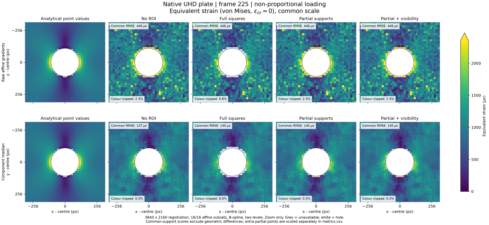
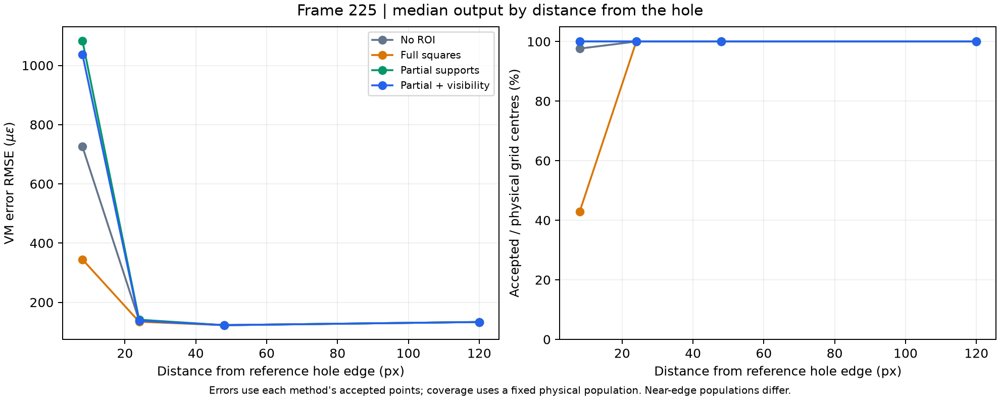

Compare masks on the native-UHD plate with a hole
============================================================

This example uses the original **3840 x 2160** analytical plate previously
processed in SYSCL. Three images and their provenance are included in
``assets/uhd_plate_hole``. The circular hole, centred at ``(1920,1080)`` with
radius 112 pixels, is traction free. The outer image edges are the limits of
the observation window in an infinite medium; they are not free specimen edges.

Prepare the reference mask
--------------------------

From the repository root:

.. code-block:: python

   import numpy as np
   from PIL import Image
   from lucas_kanade_icgn import ICGNWGPUFullPyramid

   assets = "DIC/LucasKanadeICGN/assets/uhd_plate_hole/"
   reference = np.asarray(Image.open(assets + "reference.png"))
   target = np.asarray(Image.open(assets + "frame_225.png"))
   y, x = np.ogrid[:2160, :3840]
   mask = (x - 1920)**2 + (y - 1080)**2 >= 112**2

   with ICGNWGPUFullPyramid(
       device_type="gpu", motion_model="affine", subset_size=16,
       subset_stride=16, interpolation="bspline", outlier_policy="median",
   ) as engine:
       engine.set_reference(reference, roi_mask=mask, roi_policy="full")
       result = engine.register(target)
       result.save_npz("plate-full.npz")

For a controlled comparison, keep all solver settings and images fixed. Compare
no mask, ``full``, ``partial``, and ``partial`` with
``roi_truncation="visibility"``. Keep the original reference mask as the target
hole moves. See :doc:`use-roi` and :doc:`use-partial-roi` for support semantics.

Interpret the equivalent-strain figures
---------------------------------------

The plotted Von Mises quantity is **equivalent strain**, with ``ezz=0``:

.. math::

   \varepsilon_{\mathrm{VM}} = \frac{2}{3}\sqrt{
       \varepsilon_{xx}^{2}-\varepsilon_{xx}\varepsilon_{yy}
       +\varepsilon_{yy}^{2}+3\varepsilon_{xy}^{2}}.

Here ``exx=du/dx``, ``eyy=dv/dy`` and ``exy=(du/dy+dv/dx)/2`` are obtained from
the local affine parameters. This is not stress, and it differs from the
historical SYSCL 5 by 5 displacement-regression strain operator.

   Full-UHD registration, zoomed display near the hole. Every panel and both
   load cases use a common colour scale. Top: raw gradients; bottom: explicit
   component median. Grey indicates unavailable values, white the hole.

Full squares exclude 24 centres which partial supports can calculate. All 24
solves are accepted on the tested load cases, but their raw strain estimates
have large errors. Median reduces them, without establishing near-boundary
strain accuracy. The added points' errors are reported separately from the
same 835 near-hole points accepted by all variants. Accepted correlation is a
solver status, not a calibrated strain-precision certificate.

The benchmark retains displacement, strain and invariant errors, the physical
population, geometric selection and accepted count in each distance band.
Compare coverage and error together: removing difficult boundary points can
lower an own-support RMSE without improving any retained measurement. The
nominal ROI does not guarantee isolation of image preprocessing from the hole.

   The first 16-pixel band contains 42 physical centres: 18 retained by full
   squares and 42 by partial supports. Errors use the method's accepted points;
   coverage keeps the same physical denominator.

Reproduce the analysis and figures
----------------------------------

.. code-block:: console

   $ export PYTHONPATH=DIC/LucasKanadeICGN/python/src
   $ python DIC/LucasKanadeICGN/benchmarks/benchmark_plate_hole_roi.py
   $ python -m pip install matplotlib
   $ python DIC/LucasKanadeICGN/benchmarks/plot_plate_hole_roi.py \
       DIC/LucasKanadeICGN/benchmarks/results/plate-hole-roi-20261030

Matplotlib is needed only to regenerate figures. It is not a new native-engine
dependency. Plotting works offline from the saved NPZ fields and report with
no GPU execution. PNG, PDF, signed-error maps, boundary-band plots and raw CSV
are retained for both primary and non-proportional loading.

The benchmark measures resident-image to NumPy-parameter-field throughput and
result age separately from preparation. Equivalent-strain scoring and rendering
run outside its timing window. Its FPS must not be called acquisition-to-VM FPS.

See the `complete report and raw data
<https://github.com/jeffwitz/live-dic/tree/main/DIC/LucasKanadeICGN/benchmarks/results/plate-hole-roi-20261030>`_
for the numerical results, source hashes, caveats and timing samples. The NumPy
truth is checked against the original C++ and displacement derivatives; no
mechanical truth enters the image solver.

:download:`Download the frame-225 figure as PDF <../../benchmarks/results/plate-hole-roi-20261030/von_mises_225.pdf>`.
