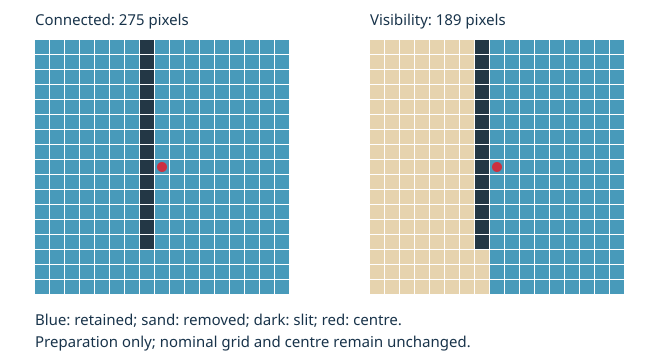

Measure with partial subsets near ROI boundaries
=================================================

``roi_policy="full"`` remains the default. Use ``partial`` explicitly when
measurements near a boundary justify using fewer pixels and a separate masked
solver. It is available in both native engines for translation and affine
models, with the existing interpolants, subset sizes, strides and spatial
weights. See :doc:`use-roi` first for reference coordinates, image conversion,
preprocessing scope, the dense grid and the basic export API.

.. code-block:: python

   from lucas_kanade_icgn import ICGNWGPUFullPyramid

   with ICGNWGPUFullPyramid(motion_model="affine", device_type="gpu") as engine:
       info = engine.set_reference(
           reference,
           roi_mask=mask,
           roi_policy="partial",
           roi_truncation="none",  # default; "visibility" is a separate heuristic
       )
       result = engine.register(current)
       result.save_npz("partial-measurement.npz")

Choose a support without moving the grid
----------------------------------------

A complete nominal square keeps its original preparation and fast solver.
For a boundary square, the engine intersects the square with the reference ROI
and retains the **4-connected component containing the central anchor**.
Disconnected islands in the same square cannot contribute.

An odd subset has one central pixel, which must be allowed. An even subset has
its geometric centre between four pixels; all four central pixels must be
allowed. This explicit conservative convention rejects a centre straddling a
crack or boundary instead of arbitrarily choosing a side. The nominal origin,
centre, stride and motion coefficients keep their existing meaning. In
particular, the affine coefficients are still evaluated at the nominal centre,
not at the centroid of the remaining support.

The support is fixed during preparation. It does not shrink or change during
target iterations. Image-bound checks use the prepared support's bounding box:
translated extrema for translation and four transformed corners for affine.
If it leaves the interpolator's permitted image domain the solve is rejected;
pixels are never removed dynamically while retaining an inconsistent Hessian.

Optional truncation near crack tips
-----------------------------------

Local connectivity alone does not prevent a support from wrapping around a
crack tip. Ncorr treats this as a separate subset-truncation operation; its
implementation uses the nearest local boundary and a contour-based cut.
See the `Ncorr manual, section 4.1
<https://ncorr.com/download/ncorrmanual_v1_2_1.pdf#page=47>`_ and
`its get_cirroi implementation
<https://github.com/justinblaber/ncorr_2D_matlab/blob/master/ncorr_datatypes.cpp>`_.

Live-dic offers ``roi_truncation="visibility"`` as a distinct, explicit
**visibility heuristic inspired by that objective**, not an identical port of
Ncorr's circular-support/contour algorithm. It retains only pixels whose
centre-to-pixel segment touches no forbidden pixel of the local component.
The test includes every closed pixel cell touched by the segment, including
corner touches. The central component is then recomputed. A ray cannot jump
over a one-pixel fissure. The segment footprints are cached by subset size;
truncation occurs only during preparation.

   The same nominal square and centre retain 275 pixels by connectivity and
   189 after visibility truncation. These are the supports from the geometry
   regression, not a reconstruction of Ncorr's contour algorithm.

This is a geometric heuristic and may remove additional useful pixels. A loss
of information can cause numerical rejection, especially for affine motion.
The geometry tests verify conservative corner touches and removal of a
connected wrap-around region. Keep the option explicit when publishing results.
It is rejected with ``full`` or without a mask.

A native-UHD controlled linear-interpolation regression assigns opposite subpixel
translations on the two sides of a slit. In the square containing its tip,
visibility reduces the centre-displacement error from more than 0.1 pixel to
less than 0.05 pixel for both models. This single constructed case demonstrates
reduced cross-side mixing; it is not a general crack-tip uncertainty bound.

The ROI is a prepared reference mask. It does not detect new cracks in a live
target. Changing the support requires finishing the stream and preparing a new
reference/ROI. Ncorr's discontinuity example also discusses a current-image ROI
and backward analysis; that additional workflow is not implemented here.

Use coherent weights and reject deficient supports
--------------------------------------------------

For a partial square, its binary local support multiplies the existing uniform
or centred Gaussian weights. The same weights define the reference mean, norm,
Jacobian products, Hessian, target mean/norm and correlation sums. The actual
sum of weights replaces the nominal pixel count, including uniform integration.
Overlapping and non-overlapping reference layouts both retain their original
pixel data and apply a support-specific centring offset.

Preparation uses double precision on the reference intensities and gradients
stored for the GPU. It computes the inverse once. Translation uses its analytic
2 x 2 inverse; affine uses its six requested parameters. There is no automatic
fallback from affine to translation.

Current admissibility controls are fixed and recorded in the ROI configuration:

* More active pixels than parameters (2 or 6), together with full numerical rank.
* Weighted intensity RMS contrast at least **1 grayscale level** in the existing
  uint8 intensity convention.
* Hessian condition number at most **1e8**, with the affine diagnostic coordinates
  normalised by nominal subset size: ``x/subset_size`` and ``y/subset_size``.

Eigenvalues/rank are evaluated in double precision. Pixel count or coverage
alone cannot make a support valid. A single-pixel-wide textured band may carry
enough information for translation while its affine Hessian remains rank
deficient. Its geometric selection stays true, its numerical reference validity
is false, and its output is a numerical rejection, not a geometric exclusion.
These controls do not promise the same uncertainty for every accepted shape;
partial-boundary error must be measured separately from complete-window error.

Qualification is performed at native **3840 x 2160**. The separate small-image
oracle checks are unit tests, not evidence of UHD accuracy. In particular,
the poor result of the small 8/8 cubic mono-scale raw case must not be extended
to the two-level B-spline/median configuration. Qualify subset sizes with the
same interpolator, iteration schedule and postprocessing, and report complete
and partial populations separately. See the UHD fractional-motion addendum in
the qualification report linked below.

For a native-UHD traction-free hole with analytical strain truth, see
:doc:`compare-plate-hole-masks`. Its added partial points demonstrate why
near-boundary strain must be qualified independently of correlation acceptance.

Keep the live path resident
---------------------------

.. code-block:: text

   prepared reference / static local supports
                        |
                 target preprocessing
                        |
                complete-window solve
                        |
              compact partial-window solve
                        |
             common permitted UOD / median
                        |
                 final dense readback

The partial solve uses the same IC-GN functions and reduction equations with a
pipeline constant enabling the local support. Complete windows compile without
per-pixel support checks. The partial list is prepared once and dispatched in
two dimensions if necessary, retaining dense output indices. Each workgroup
loads its support bits once into shared memory. Excluded pixels are skipped
before target interpolation and all lanes join the existing reductions/barriers.

The existing filter storage buffer holds finite FIR float bit patterns followed
by integer counts, subset indices and support words. It is declared as uint32
storage; only FIR words are bitcast back to float. No floating NaN payload
represents geometry, and no additional storage-buffer binding or optional GPU
feature is required. A 16 x 16 local binary support uses 32 bytes of bits before
metadata. Static buffers are shared by every in-flight slot.

There is an extra solve pass for partial windows, but no per-frame support
construction, Hessian inversion, mask upload, shader compilation, or intermediate
CPU readback in the full pyramid. Missing coarse seeds still permit a selected
fine point to start from zero. Conservative mask reduction, seed permissions
and neighbourhood screening use the reference ROI rules in :doc:`use-roi`.

Inspect and export support diagnostics
--------------------------------------

``info.roi.partial_indices`` contains dense, row-major grid indices of geometric
partial windows. ``support_words`` has one uint32 row per partial window;
bit 0 is local pixel (0, 0), followed by row-major pixels. ``support_boxes``
contains inclusive local ``(xmin, ymin, xmax, ymax)`` pixel bounds.
``coverage`` is the unweighted active pixel fraction over the nominal square.

``support_condition``, ``support_rank`` and ``support_contrast`` are dense static
diagnostic arrays for partial windows. Zero condition means undefined/not
computed, and complete windows have zero entries in these partial-only arrays;
use ``reference_valid`` for actual numerical admissibility. ``populations``
reports the number of geometric partial windows as ``roiPartial``.
The internal pending marker -4 never appears in completed results.

NPZ exports include these arrays, the original image mask, geometric selection,
actual local support words, numerical reference validity and strict JSON
configuration. A sequence archive requires one prepared ROI; different
preparations are exported separately. Read all arrays with ``allow_pickle=False``.

.. code-block:: python

   from lucas_kanade_icgn.roi import unpack_support

   ordinal = 0
   local_mask = unpack_support(info.roi.support_words[ordinal], engine.subset_size)

Qualification and timing
-------------------------

The numerical tests compare partial translation/affine iterates to an independent
double-precision matrix solver, using bilinear target sampling, both uniform and
Gaussian weights, even/odd sizes and overlap. The comparison includes finite
non-converged iterates under a fixed iteration budget; a valid support does not
guarantee convergence to an arbitrarily tight tolerance. Separate tests qualify
the normal pyramidal path, sparse retry, streaming, reconfiguration, all-true and
empty masks, export and geometry.

Use the actual mask and policy in the stream benchmark:

.. code-block:: console

   $ python DIC/LucasKanadeICGN/benchmarks/benchmark_image_to_field.py \
       --backend native-pyramid --device-type gpu --roi-mask mask.npy \
       --roi-policy partial --roi-truncation visibility \
       --motion-model affine --pipeline-depth 2 --warmups 12 --frames 160

Preparation and live execution are separate measurements. Report complete and
partial populations and error separately; the cost and uncertainty depend on
boundary geometry and available texture. No universal zero-overhead or 4K60
guarantee applies to partial supports.
The measured UHD populations, errors and raw campaigns are linked from
:doc:`../reference/performance`.
