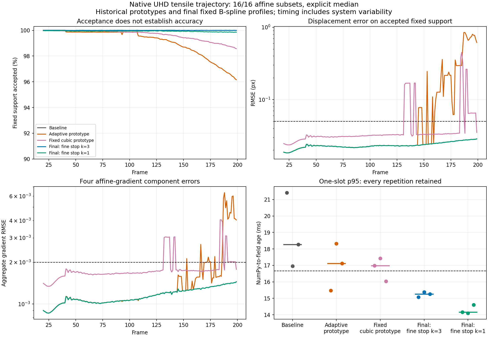
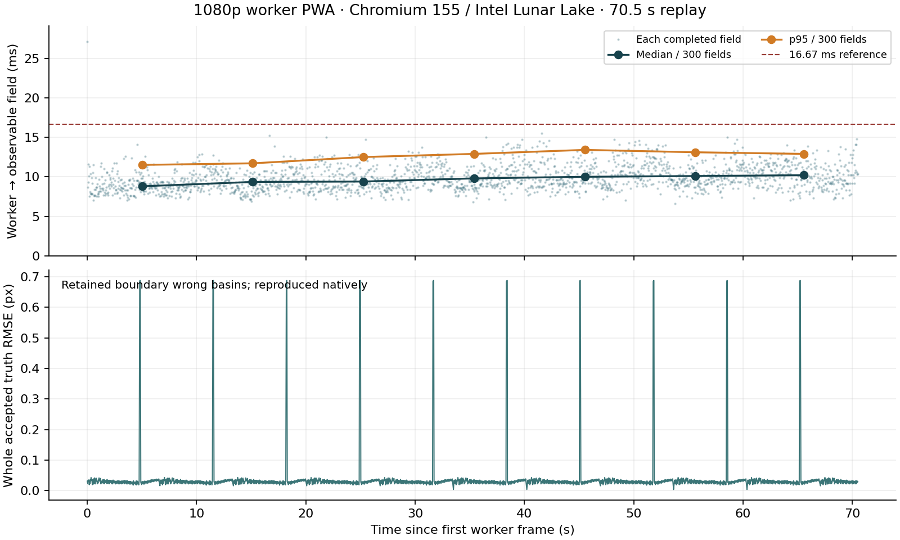

Performance and GPU hardware coverage
=====================================

This page distinguishes current qualified profiles from explicitly versioned
prototype controls. Failed latency experiments are retained with their source
snapshots, not presented as current fast configurations. Re-run the documented
commands whenever a kernel, driver, browser, or timing boundary changes.

The results are machine-specific regression references, not portable
performance guarantees.

For the 200-frame native-UHD tensile trajectory, see the
:ref:`qualified one-slot latency profile <latency-reduction-profile>`.

How to read this page
---------------------

There is no single FPS number independent of the workload. The backend
comparison below uses tiled small-image fixtures and default displacement UOD.
The native-UHD tensile campaigns use analytic images, chronological temporal
initialization and explicit median smoothing. Fixed-pair workgroup experiments
repeat one image; changing-frame campaigns exercise a sequence. Their times
must not be pooled or treated as interchangeable results.

Each detailed table retains its original configuration and revision. The
workgroup-width controls and negative latency experiments are evidence for
those revisions, not fresh measurements of the current checkout. See
the repository `contribution guide
<https://github.com/jeffwitz/live-dic/blob/main/CONTRIBUTING.md>`_ for development
checks; hardware performance must be remeasured separately when relevant code
or deployment conditions change.

.. _gpu-hardware-coverage:

GPU hardware coverage
---------------------

**Native 3840 x 2160 full-pyramid DIC benchmarks have completed on AMD,
Intel and NVIDIA GPUs.** The portable WGSL solver has executed through
wgpu-native/Vulkan on all four adapters below, covering integrated and
discrete hardware with 16 and 32 invocations per workgroup. These observed
runs demonstrate portability across the tested GPU/driver configurations.

.. list-table:: Observed native Linux/Vulkan coverage
   :header-rows: 1
   :widths: 24 24 27 25

   * - GPU / driver
     - Completed workload
     - Numerical evidence
     - Full GPU regression suite
   * - AMD Radeon 780M, RADV Phoenix, Mesa 25.0.7
     - 200-frame UHD tensile trajectory; 12 runs, both widths and depths 1/2
     - All timed frames pass the fixed-interior quality gates
     - All 193 tests passed after the lifecycle correction below
   * - Intel Lunar Lake, Mesa 25.2.8
     - 200-frame UHD tensile trajectory; 12 runs, both widths and depths 1/2
     - All timed frames pass the fixed-interior quality gates
     - Archived campaign reports all 191 tests passed
   * - Intel UHD Graphics, Tiger Lake GT1, Mesa 26.0.8
     - Fixed UHD tensile pair; 30 measured calls per width after 30 warmups
     - Same acceptance/status across widths; field difference RMSE 1.98e-5 px
     - No full-suite pass documented for this experiment
   * - NVIDIA GeForce RTX 3080 Laptop, driver 595.99.02
     - Fixed UHD tensile pair; 30 measured calls per width after 30 warmups
     - Same acceptance/status across widths; field difference RMSE 1.72e-5 px
     - No full-suite pass documented for this experiment

Evidence: :ref:`fixed-pair-workgroups` for NVIDIA and Tiger Lake,
:ref:`intel-changing-workgroups` and the :download:`Intel campaign report
<../../benchmarks/results/workgroup-width-20261030/README.md>` for Lunar Lake,
and :ref:`amd-changing-workgroups` with the :download:`AMD campaign report
<../../benchmarks/results/workgroup-width-amd-20261030/README.md>` and
:download:`AMD summary
<../../benchmarks/results/workgroup-width-amd-20261030/summary.json>`.
NVIDIA and Tiger Lake field differences compare workgroup widths; they are
not ground-truth displacement errors or a temporal-trajectory qualification.

The AMD campaign's twelve benchmark processes and both untimed diagnostic
replays completed before the full-suite failure. The latter reproduced twice,
and the affected test
``CorrectedTemporalTests.test_zero_default_and_first_temporal_frame_match_bitwise``
also aborted alone. RADV reported a rejected command submission (``-28``),
then wgpu reported ``Parent device is lost`` in ``wgpuQueueSubmit`` and the
process exited with code 134.

The lifecycle investigation reproduced a resource exhaustion problem:
``close()`` destroyed image buffers but retained pipelines, bind groups and
the device. The test retained closed engines through ``addCleanup`` bound
methods. GTT usage grew by about 270 MB per engine until it approached the
host's 4 GiB GTT budget, where the next registration was rejected. A
controlled replay releasing the references completed the same 27-engine
test. Destroying the device alone, while retaining its pipeline wrappers,
was insufficient.

Native owner close now destroys its device, drops GPU wrapper/cache
references and collects cyclic wrappers; shared levels release their own
references without destroying the owner's device. The previously failing
test passes after the correction, and new regression tests cover retained
closed engines and shared-device ownership. The full GPU-enabled suite then
passed all 193 tests locally on this AMD host in 83.766 seconds. The portable
run passed 121 tests with 72 GPU tests explicitly skipped; Ruff and the strict
Sphinx HTML build also passed. This is a subsequent local validation of the
working-tree correction, not a claim that the original pre-fix suite passed.
See the :download:`lifecycle
investigation
<../../benchmarks/results/workgroup-width-amd-20261030/device-lifecycle/README.md>`
for logs and final validation outcomes. The original campaign measurements
precede this cleanup correction; their raw reports and source hashes remain
unchanged.

This coverage supports using the native implementation across these tested
vendors. It does not certify every feature, browser backend, operating system,
driver or recent GPU. A new deployment still needs its own accuracy,
stability and timing checks. Workloads and revisions differ between
campaigns, so their timings are not a controlled ranking of GPU performance.
All timings start with a resident NumPy image and end with a materialized
NumPy field (including statistics for the changing-frame campaigns); camera
acquisition is excluded. Functional execution does not imply 4K60 on every
device: the measured Tiger Lake fixed-pair call already exceeds 16.67 ms.

Current backend policy
----------------------

* live-dic is evaluated first as a Python-supervised NumPy pipeline. See
  :doc:`../explanation/supervision`.
* ``ICGNWGPUFullPyramid()`` with two levels is the recommended product
  configuration for that boundary.
* ``ICGNWebGL(backend="webgpu-wgsl")`` executes the same two-level
  full-pyramid WGSL graph in Chromium.
* ``ICGNWebGL()`` is the Python-controlled browser compatibility entry point
  and selects the optimized Three.js/TSL single-scale WebGPU solver. It is not
  the low-latency NumPy recommendation and has no WebGL fallback.
* Both native engines expose bounded sequence execution. ``ICGNWGPU()`` is
  the single-scale engine; its optional selective recovery is not the normal
  pyramid path.
* Historical GPU-IO and WebGL2 reports are retained only as archived evidence;
  those implementations have been removed and are not supported-backend
  performance claims.

See :doc:`../explanation/backend-selection` for the complete decision table.

Validation machine
------------------

.. list-table:: Hardware and software environment
   :header-rows: 1

   * - Component
     - Value
   * - Measurement date
     - 2026-10-29
   * - CPU
     - Intel Core Ultra 5 228V, 8 cores
   * - GPU
     - Intel Lunar Lake integrated graphics ``8086:64a0``
   * - Kernel driver
     - ``xe``
   * - Operating system
     - Ubuntu 24.04.5 LTS
   * - Kernel
     - Linux 7.0.0-38-generic
   * - Browser
     - Chromium 155.0.8059.79 snap
   * - Browser WebGPU
     - Three.js r186, Intel Xe2-LPG Vulkan adapter
   * - Native WebGPU
     - wgpu-py 0.32.0, wgpu-native Vulkan, same physical GPU

Backend-comparison workload and protocol
----------------------------------------

The offline validation images are tiled to 3840 x 2160. The resulting grid is
240 x 135, or 32,400 subsets with ``subset_size=16`` and the default
``subset_stride=16``. The primary backend-comparison table uses nonoverlapping
subsets; other experiments state their own geometry. Its affine and translation rows use
Gaussian/inverse-spline target filtering, 4 x 4 cubic B-spline interpolation,
a ``5e-3`` fine-scale tolerance, minimum ZNCC ``0.8``, and the default
displacement UOD pass. No camera or H.264 stage is included.

Primary backend performance measurements use
``outlier_policy="replace"``. It tests only displacement and replaces the
complete local state after a trigger. ``flag`` and ``disabled`` are scientific
control modes. ``median`` is an explicit smoothing mode and is not represented
by the default performance rows. See
:doc:`../explanation/displacement-outliers` for the exact rule and the
false-positive, injected-outlier, and localized-feature regressions.
Quadratic performance remains reported separately because its state and solver
cost differ from affine mode.

Primary image-to-field stream measurements
------------------------------------------

The primary deployable boundary starts with an already acquired, contiguous
``uint8`` NumPy grayscale image and stops only after the complete NumPy
parameter field, status, iterations, and statistics are available to Python.
Reference preparation, camera acquisition, and decoding are excluded.

The persistent engines process a changing sequence which cycles the four
distinct qualified ``frame_001``, ``frame_005``, ``frame_010``, and
``frame_020`` fixtures. Three warm-ups precede 12 measured frames. Calls are
synchronous, so latency, result age, and stream period describe the same
one-frame-at-a-time execution. Browser rows report the median of three
campaigns after the binary transport change.

.. list-table:: UHD resident-image to materialized-field performance
   :header-rows: 1

   * - Backend and model
     - Median / p95 latency
     - Sustained throughput
   * - Native full pyramid, 2 levels, affine
     - **11.571 / 12.185 ms**
     - **85.37 FPS**
   * - Native full pyramid, 2 levels, translation
     - **10.992 / 11.397 ms**
     - **90.72 FPS**
   * - Raw browser WGSL, 2 levels, affine
     - **41.094 / 44.423 ms**
     - **24.27 FPS**
   * - Raw browser WGSL, 2 levels, translation
     - **39.996 / 43.995 ms**
     - **24.82 FPS**
   * - Three.js/TSL, 1 scale, affine
     - **43.203 / 56.336 ms**
     - **21.91 FPS**
   * - Three.js/TSL, 1 scale, translation
     - **39.666 / 44.002 ms**
     - **25.14 FPS**

.. _fixed-pair-workgroups:

Portable native workgroup-size experiment
-----------------------------------------

The portable native solver accepts widths 16, 32, and experimental 128.
Sixteen remains the default. This experiment compared 16 and 32 on an
RTX 3080 Laptop PC and its integrated Intel UHD Graphics adapter. It
uses the same two-level affine full-pyramid engine and a fixed native-UHD
tensile pair (``reference.png`` to ``frame_040.png``), decoded once into
contiguous NumPy arrays. The reference was prepared once; after 30 warm-ups,
each table cell summarizes 30 calls on the same target. Times include the
complete resident-NumPy-image to materialized-field call.

.. list-table:: Native UHD workgroup-size measurements on this PC
   :header-rows: 1

   * - Vulkan adapter
     - 16 invocations, median / p95
     - 32 invocations, median / p95
     - Median change
   * - NVIDIA GeForce RTX 3080 Laptop GPU, driver 595.99.02
     - 11.31 / 12.53 ms
     - **9.66 / 9.89 ms**
     - **14.6% faster**
   * - Intel UHD Graphics (Tiger Lake GT1), Mesa 26.0.8
     - 55.41 / 59.03 ms
     - **46.97 / 50.44 ms**
     - **15.2% faster**

Both widths accepted exactly 31,650 of 32,400 subsets and produced identical
status maps on both adapters. The displacement-field RMSE between widths was
``1.72e-5`` px on the RTX and ``1.98e-5`` px on the Intel UHD. Floating-point
reduction order changed the iteration count for 42 RTX subsets and 55 Intel
subsets, without changing acceptance status.

The PC has an Intel Core i7-11800H, Ubuntu 26.04.1, and Linux 7.0.0-38. The
measurements used Python 3.12.14, NumPy 2.5.4, and wgpu-py 0.32.0. NVIDIA
sample times fell during the 30-call measurement, so the p95 retains the
slower early samples; this is a machine-specific experiment, not a fixed-clock
or cross-device guarantee. It is also a fixed-pair experiment, not the
changing-frame campaign above.

Select the width in Python with
``ICGNWGPUFullPyramid(solver_workgroup_size=32)`` or
``ICGNWGPU(solver_workgroup_size=32)``. The native default remains 16, and a
32-invocation request selects the portable solver; the separate subgroup
solver remains specialized for 16 invocations. The benchmark utility accepts
``--workgroup-size 16`` or ``--workgroup-size 32`` for its synthetic UHD A/B
runs.

.. _intel-changing-workgroups:

Changing-frame control on Intel Lunar Lake
~~~~~~~~~~~~~~~~~~~~~~~~~~~~~~~~~~~~~~~~~~

A separate matched campaign on the Intel Graphics LNL / Mesa 25.2.8 machine
compared widths on the 200-frame native-UHD tensile trajectory. It used affine
16/16, B-spline, median postprocessing, two fixed levels, temporal velocity
prediction, fine correction, and finest-only conservative stopping. Only
``solver_workgroup_size`` changed. Three alternating runs measured 180 fields
each after warmup and chronological priming. The boundary includes the resident
NumPy image through the materialized NumPy field and statistics.

.. list-table:: Matched changing-frame campaign, performance power profile
   :header-rows: 1

   * - Invocations / slots
     - Sustained FPS
     - Result age p50 / p95 / p99
   * - 16 / 1
     - **82.26**
     - **12.13 / 13.82 / 14.86 ms**
   * - 32 / 1
     - 69.74
     - 14.65 / 18.66 / 19.73 ms
   * - 16 / 2
     - 88.62
     - 22.60 / 25.44 / 26.04 ms
   * - 32 / 2
     - 74.61
     - 27.15 / 35.57 / 36.26 ms

FPS is the median of three runs; age quantiles pool 540 samples per row.
Both widths pass the existing fixed-interior quality gates: minimum coverage
99.985%, maximum displacement RMSE about 0.02858 px, and strain aggregate RMSE
below 0.001447. Mean fine/coarse iteration counts are essentially unchanged.
Whole-grid edge failures remain, including a maximum frame RMSE of 3.2865 px;
the interior qualification does not cover those points.

Width 32 loses 15.2% throughput at one slot on this machine and exceeds the
16.67 ms p95 age budget. Keep width 16 here. The different fixed-pair results
above do not imply a portable benefit from width 32. No default changed.
See the :download:`strict summary
<../../benchmarks/results/workgroup-width-20261030/summary.json>` and the
`full campaign, commands, samples and final fields
<https://github.com/jeffwitz/live-dic/tree/main/DIC/LucasKanadeICGN/benchmarks/results/workgroup-width-20261030>`_.
These finite campaigns do not establish a universal deadline.

128-invocation control on Intel Lunar Lake
~~~~~~~~~~~~~~~~~~~~~~~~~~~~~~~~~~~~~~~~~~~~~~~~~~

The subsequent explicit 128-invocation experiment remeasured a width-16
control with the same trajectory, settings and three alternating repeats.
It retained B-spline, the two fixed levels and the qualified temporal profile.

.. list-table:: Matched native-UHD 16 versus 128 invocation control
   :header-rows: 1

   * - Invocations / slots
     - Sustained FPS
     - Result age p50 / p95 / p99
   * - 16 / 1
     - **81.30**
     - **12.35 / 13.85 / 14.35 ms**
   * - 128 / 1
     - 53.61
     - 18.80 / 23.05 / 24.06 ms
   * - 16 / 2
     - 88.63
     - 22.59 / 25.39 / 26.13 ms
   * - 128 / 2
     - 57.50
     - 34.25 / 43.60 / 45.27 ms

FPS is the median of three runs, and ages pool 540 timed fields per row.
Both widths pass the unchanged interior quality gates: minimum coverage
99.985%, maximum displacement RMSE below 0.028579 px, and strain aggregate
RMSE below 0.001447. Mean fine iterations remain about 2.5793 for both widths.
Whole-grid edge failures remain, with maximum frame RMSE about 3.2865 px.

Width 128 loses 34.1% throughput at one slot here. It misses both the 60 FPS
throughput goal and the 16.67 ms p95 age budget. The default stays 16;
``solver_workgroup_size=128`` is available only as an explicit experimental
choice. No GN equation or iteration limit was changed. See the
:download:`strict summary
<../../benchmarks/results/workgroup-128-20261030/summary.json>` and the
`full 128-invocation campaign
<https://github.com/jeffwitz/live-dic/tree/main/DIC/LucasKanadeICGN/benchmarks/results/workgroup-128-20261030>`_
for commands, source hashes, all repetitions and final fields.

.. _amd-changing-workgroups:

Changing-frame control on AMD Radeon 780M
~~~~~~~~~~~~~~~~~~~~~~~~~~~~~~~~~~~~~~~~~

The same matched campaign ran on the Radeon 780M integrated in the Ryzen 7
PRO 7840U, using RADV Phoenix / Mesa 25.0.7, Linux 6.17.0-29, Python 3.12.3,
NumPy 2.5.4 and wgpu-py 0.32.0. Code commit was
``c0c072c24c7bf52a93aaee58b4e754a954ef7d36``. All twelve runs retained the
``performance`` power profile and identical source and input hashes within
this campaign. These are new AMD observations, not a replay on Intel.

Inputs were 200 hash-verified native 3840 x 2160 tensile images. Affine
B-spline solving used subsets/stride 16, median postprocessing, two fixed
levels, iteration caps (8, 16), temporal velocity prediction, fine correction
and conservative finest-level stopping. Twenty warmups, a history reset and
twenty chronological priming frames preceded the 180 timed frames per run.
Widths alternated in order over three repetitions, at depths 1 and 2.

.. list-table:: AMD resident-NumPy-image to materialized-field and statistics
   :header-rows: 1

   * - Invocations / in-flight images
     - Sustained FPS
     - Result age p50 / p95 / p99
   * - 16 / 1
     - 74.81
     - 13.105 / 16.109 / 16.513 ms
   * - 32 / 1
     - 77.25
     - 12.859 / 16.404 / 16.998 ms
   * - 16 / 2
     - 79.70
     - 25.001 / 29.079 / 29.963 ms
   * - 32 / 2
     - 84.04
     - 23.872 / 28.580 / 29.212 ms

FPS is the median of three run throughputs; age percentiles pool 540 timed
fields per row. With one image in flight, width 32 improves throughput by
3.26%, while width 16 has a slightly lower pooled p95. Each one-image run
exceeds 60 FPS and stays below 16.67 ms p95. Two images increase throughput
and result age. This does not establish a universal deadline or a portable
advantage for width 32; defaults remain unchanged.

Every timed frame passes the fixed-interior gates on 26,924 positions:
minimum coverage 99.9851%, maximum displacement RMSE below 0.028579 px,
maximum displacement error p95 below 0.053071 px, and maximum strain
aggregate RMSE below 0.001447. Final-field displacement-vector RMSE between
widths is 0.00010093 px on jointly accepted interior points. Whole-grid edge
failures remain: worst frame displacement RMSE is about 3.2865 px and
minimum accepted coverage is 89.99%. The passing interior gates do not
qualify those edges.

The :download:`AMD report
<../../benchmarks/results/workgroup-width-amd-20261030/README.md>` contains
commands, configuration, provenance and validation outcomes; the
:download:`summary
<../../benchmarks/results/workgroup-width-amd-20261030/summary.json>` contains
the recomputed statistics. The subsequent GPU-suite device-loss failure,
its lifecycle cause and the correction are recorded in
:ref:`gpu-hardware-coverage`.

Primary Intel Lunar Lake UOD policy control
-------------------------------------------

.. list-table:: Native displacement-UOD policy control
   :header-rows: 1

   * - Model and policy
     - Median / p95 latency
     - Throughput
     - Median / maximum RMSE
   * - Affine, ``replace``
     - 11.571 / 12.185 ms
     - 85.37 FPS
     - 0.04161 / 0.06274 px
   * - Affine, ``disabled``
     - **10.851 / 11.436 ms**
     - **92.24 FPS**
     - 0.04161 / 0.07810 px
   * - Translation, ``replace``
     - 10.992 / 11.397 ms
     - 90.72 FPS
     - **0.03590 / 0.04063 px**
   * - Translation, ``disabled``
     - **10.095 / 10.539 ms**
     - **98.63 FPS**
     - 0.04487 / 0.06548 px

Omitting the post-pass saved about 0.72 ms affine and 0.90 ms translation in
these campaign medians. ``disabled`` is not numerically equivalent to the
default: no wrong-basin replacement occurs, and the maximum error increased on
this sequence. Current production tables therefore use ``replace``. The raw
mode is intended for solver studies, explicit downstream outlier handling, and
isolated timing.

The native and raw-browser WGSL rows execute the same two-level algorithm.
Their host paths remain different. Native wgpu uploads NumPy bytes in-process
and reads one packed state buffer. The browser API now transfers each
contiguous grayscale frame unchanged over a persistent same-origin binary long
poll and returns one packed binary state field. It no longer performs
per-frame PNG encoding, data-URL transport, image decoding, or JSON field
serialization. Three.js also keeps the upload packed at four 8-bit pixels per
word and expands it on the GPU.

Quadratic-model qualification measurement
-----------------------------------------

The quadratic model has a distinct cost and is not included in the affine and
translation table above. On the same validation machine, a dedicated
three-campaign run used a two-level native full pyramid, 32 x 32 subsets,
direct Keys-cubic interpolation, one target in flight, three warm-ups, and 12
changing UHD frames per campaign. The resident NumPy image to materialized
12-component NumPy field boundary measured:

* campaign median latencies of 61.940, 56.017, and 71.522 ms;
* campaign p95 latencies of 85.279, 78.054, and 107.940 ms;
* sustained throughput of 16.98, 17.31, and 14.64 FPS;
* 7,580 to 7,788 accepted subsets on the 120 x 67 grid;
* approximately 3.17 s of excluded one-time reference preparation.

This is a correctness-oriented first implementation, not a 4K60 quadratic
result. Its exact second-order composition currently inverts a lifted 6 by 6
increment operator for every active subset and iteration. The measurement
therefore establishes the current engineering baseline and keeps it separate
from the much faster affine and translation models.

Reproduce it from the repository root with::

   python3 DIC/LucasKanadeICGN/benchmarks/benchmark_image_to_field.py \
     --backend native-pyramid --motion-model quadratic \
     --subset-size 32 --interpolation cubic --pyramid-levels 2 \
     --pipeline-depth 1 --warmups 3 --frames 12 --campaigns 3

Across the four changing fixtures, affine native and raw WGSL accepted 31,258
to 31,654 subsets with 0.06466 px maximum truth RMSE. Translation native
accepted 31,312 to 31,654 with 0.04063 px maximum RMSE; raw WGSL differed by at
most one accepted subset and less than ``2e-6`` px in maximum RMSE. Three.js is
single-scale, so its difficult-frame acceptance is not algorithmically
comparable to the two-level paths.

The binary path removes the former hundreds of milliseconds of serialization,
but an UHD frame still crosses the Python/Chromium process boundary, is copied
into a GPU resource, and the field crosses back. In the current affine runs,
the browser body copy took about 9.8 ms median and the synchronized GPU graph
about 17--20 ms. Complete calls sustain about 20--22 FPS, so the browser
path is still not a 60 Hz NumPy stream. The current native timing contract
separates input normalization, direct texture
upload, command encoding, queue submission, blocking completion wait,
mapped-buffer copy, and NumPy result construction. For a synchronous
translation call in a four-run sequence campaign, representative medians were
0.019, 0.694, 0.449, 0.096, 8.703, 0.145, and 0.339 ms,
respectively. The completion wait is host blocking time, not an isolated GPU
timestamp.

Reproduce this campaign with:

.. code-block:: bash

   python benchmarks/benchmark_image_to_field.py \
     --width 3840 --height 2160 --frames 12 --warmups 3 --campaigns 3 \
     --backend three-tsl --backend webgpu-wgsl \
     --motion-model translation

Native full-pyramid bounded stream
----------------------------------

``ICGNWGPUFullPyramid.register_stream`` allocates independent target textures,
pyramid reductions, solver states, transferred seeds, and final readbacks for
each in-flight slot. Immutable reference data and pipelines remain shared.
The input is uploaded directly from the contiguous NumPy buffer; no PNG,
browser, DevTools, or JSON conversion is involved.

The following campaign used four runs, each with eight warm-ups and 50 changing
UHD frames. The table reports the median campaign. Result age starts when the
iterator accepts a NumPy frame and ends after its complete NumPy field and
statistics have been constructed. Stream period is total wall-clock duration
divided by 50; it is the correct sustained-throughput metric even when
completed results arrive in short bursts.

.. list-table:: Native two-level full-pyramid stream trade-off
   :header-rows: 1

   * - Model and targets in flight
     - Median / p95 result age
     - Stream period
     - Throughput
   * - Affine, depth 1
     - **11.354 / 11.899 ms**
     - 11.368 ms
     - 88.00 FPS
   * - Affine, depth 2
     - 21.008 / 21.683 ms
     - **10.471 ms**
     - **95.51 FPS**
   * - Affine, depth 3
     - 31.761 / 35.991 ms
     - 10.523 ms
     - 95.03 FPS
   * - Translation, depth 1
     - **10.496 / 11.229 ms**
     - 10.708 ms
     - 93.43 FPS
   * - Translation, depth 2
     - 19.131 / 19.665 ms
     - **9.607 ms**
     - **104.09 FPS**
   * - Translation, depth 3
     - 29.854 / 36.126 ms
     - 9.655 ms
     - 103.57 FPS

Depth one remains the low-age choice. Depth two is the recommended
throughput/latency compromise: it gains 8.5% affine throughput and 11.4%
translation throughput over depth one, while approximately doubling result
age. A third slot does not improve throughput and increases median age above
29 ms.

Reproduce one row with:

.. code-block:: bash

   python benchmarks/benchmark_image_to_field.py \
     --backend native-pyramid --width 3840 --height 2160 \
     --campaigns 4 --frames 50 --warmups 8 --pipeline-depth 2 \
     --motion-model affine

Kernel configuration represented by the results
------------------------------------------------

* shared WGSL FIR: 32 x 8 horizontal and 8 x 32 vertical output tiles in
  workgroup memory, with the central 25 coefficients of the compatible
  31-value record;
* Three.js FIR: a 16 x 16 output tile and all 31 coefficients;
* Three.js solver: the measured 32-lane hardware subgroup, eight subset pixels
  per lane on the validation GPU;
* portable shared-WGSL solver: one 16-, 32-, or experimental 128-lane workgroup per subset in the
  native engine (16 by default); browser WGSL uses 16 lanes;
* full pyramid: GPU-resident five-tap reduction, per-level FIR coefficients,
  affine seed transfer, seeded solves, final UOD pass, and one packed
  readback.

The opt-in GPU tests validate partial FIR tiles, exact integer pyramid
reduction, fresh seeded state, selective-retry neighbour preservation, and the
translation-only fractional-displacement contract. They also verify complete-
state replacement and flag-only preservation for an injected displacement
outlier, at most 1% false positives on a healthy noisy field, preservation of
a one-subset-wide affine-gradient band, and exact agreement of the explicit
3 by 3 median with an independent translation/affine/quadratic oracle. The
portable suite and the opt-in GPU suite are both executed in CI; the latter
must not convert shader, adapter, or execution failures into skipped tests.

Timing boundaries
-----------------

.. list-table:: Reported boundaries
   :header-rows: 1

   * - Boundary
     - Includes
     - Excludes
   * - Browser GPU timestamp
     - FIR, reductions when configured, IC-GN, seed transfer, optional UOD pass
     - upload, Python transport, readback
   * - Browser synchronized wall time
     - the same GPU graph plus browser synchronization
     - Python transport and result conversion
   * - Native complete Python call
     - validation, upload, GPU graph, packed readback, NumPy result statistics
     - acquisition and downstream consumers
   * - Sequence period
     - total bounded-stream wall time divided by returned frames
     - result age when more than one frame is in flight
   * - Acquisition-to-result
     - the deployed measurement pipeline
     - nothing relevant to the application deadline

Reproduce the current campaign
------------------------------

Native full pyramid:

.. code-block:: console

   $ PYTHONPATH=DIC/LucasKanadeICGN/python/src \
       python3 DIC/LucasKanadeICGN/benchmarks/benchmark_wgpu_full_pyramid.py \
       --width 3840 --height 2160 --levels 2 3 --warmups 8 --repeats 50

Raw browser WGSL:

.. code-block:: console

   $ PYTHONPATH=DIC/LucasKanadeICGN/python/src \
       python3 DIC/LucasKanadeICGN/benchmarks/benchmark_4k.py \
       --backend webgpu-wgsl --pyramid-levels 2 \
       --translation 4 -2 --warmups 8 --repeats 50

Three.js nominal and difficult pairs:

.. code-block:: console

   $ PYTHONPATH=DIC/LucasKanadeICGN/python/src \
       python3 DIC/LucasKanadeICGN/benchmarks/benchmark_4k.py \
       --backend three-tsl --translation 2 -1 --warmups 8 --repeats 50

   $ PYTHONPATH=DIC/LucasKanadeICGN/python/src \
       python3 DIC/LucasKanadeICGN/benchmarks/benchmark_4k.py \
       --backend three-tsl --translation 4 -2 --warmups 8 --repeats 50

Native sequence pipeline:

.. code-block:: console

   $ PYTHONPATH=DIC/LucasKanadeICGN/python/src \
       python3 DIC/LucasKanadeICGN/benchmarks/benchmark_wgpu_pipeline.py \
       --repeats 30 --warmups 5 --campaigns 4 --depths 1 2 3

Run the hardware regressions before publishing a new campaign:

.. code-block:: console

   $ ICGN_RUN_GPU_TESTS=1 PYTHONPATH=DIC/LucasKanadeICGN/python/src \
       python3 -m unittest discover \
       -s DIC/LucasKanadeICGN/python/tests -p 'test_*.py' -v

External SYSCL comparison
-------------------------

The related SYSCL project remains part of the algorithmic provenance, but
there is currently no qualified apples-to-apples timing row. Add one only
after both projects are run on the same machine, input, iteration schedule,
and explicitly equivalent timing boundary.

Interpretation
--------------

These measurements demonstrate offline 4K60 processing margin on one GPU and
one controlled dataset. They do not include camera acquisition, frame-arrival
jitter, a codec, downstream processing, or operating-system deadline
guarantees. Median and p95, accepted subsets, RMSE, queue depth, and result
latency must be reported together when qualifying a deployment.

Full-window ROI qualification
-----------------------------

The native ``full`` ROI implementation has a separate
`qualification report with raw stream campaigns
<https://github.com/jeffwitz/live-dic/tree/main/DIC/LucasKanadeICGN/benchmarks/results/roi-full-20261030>`_.
It measures translation and affine execution, the original UHD tensile images,
all-true/absent masks, compact/fragmented regions and the optional subgroup path.
The observed hardware drift prevents a conclusive real-time non-regression
decision within the predeclared margins. These ROI campaigns do not replace
the established unmasked measurements above. See :doc:`../how-to/use-roi`.

Partial-support ROI qualification
---------------------------------

The explicitly enabled ``partial`` policy has its own
`UHD report and raw campaigns
<https://github.com/jeffwitz/live-dic/tree/main/DIC/LucasKanadeICGN/benchmarks/results/roi-partial-20261030>`_.
It separates complete and partial-window accuracy, preparation cost and actual
stream latency/throughput, including optional visibility truncation. Translation
uses pure shifts of the original UHD reference; affine uses its archived tensile
frame 40. Hardware drift keeps temporal non-regression reception open. These
measurements do not establish a universal zero-overhead partial mode.
See :doc:`../how-to/use-partial-roi` for support definitions and limits.

The `native-UHD fractional-motion and crack addendum
<https://github.com/jeffwitz/live-dic/blob/main/DIC/LucasKanadeICGN/benchmarks/results/roi-partial-20261030/uhd-fractional.md>`_
qualifies 8/8 and 16/16 on a known fractional translation using both the original
UHD speckle and a continuous analytic UHD texture. It distinguishes raw and
median fields, single-level cubic and two-level B-spline, and includes the
full-UHD visibility case. Small-image oracle tests do not substitute for these
qualification runs.

.. _latency-reduction-profile:

Qualified one-slot latency profile
-----------------------------------

The final ``latency-reduction-20261030`` control uses affine B-spline,
uniform 16/16 subsets, explicit median, a fixed reference, two fixed levels,
temporal initialization, velocity prediction, fine correction and
``divergence_patience=3, divergence_min_iterations=4``. Stagnation stopping
applies only at the finest level: both levels run on every image and coarse
caps/tolerances remain intact. No ROI or stride reduction is used.

Boundary: resident uint8 NumPy image to materialized NumPy field and statistics.
Twenty targets warm the actual slots, history is reset, twenty targets restore
history, then frames 20--199 are timed. Three alternating process runs use
Intel LNL / Vulkan Mesa 25.2.8, wgpu-py 0.32.0, performance profile. The following
central values are medians of campaign statistics; the p95 column retains
the full range across the three runs.

.. list-table:: Final B-spline profiles; all caps remain (8,16)
   :header-rows: 1

   * - Finest stopping
     - Slots
     - FPS
     - Age median
     - Per-run p95 range
     - Pooled p95
   * - Conservative: k=3, minimum 4
     - 1
     - 77.77
     - 12.76 ms
     - 15.07--15.38 ms
     - 15.26 ms
   * - Conservative: k=3, minimum 4
     - 2
     - 84.75
     - 23.62 ms
     - 27.04--27.12 ms
     - 27.11 ms
   * - Aggressive: k=1, minimum 2
     - 1
     - 81.05
     - 12.10 ms
     - 14.10--14.60 ms
     - 14.28 ms

Both one-slot profiles pass the predeclared finite timing and quality gates.
Prefer the conservative profile. Its worst fixed-support displacement RMSE is
0.028578 px, p95 error 0.053065 px, gradient-component RMSE 0.001446, and
coverage 99.9851%. An untimed same-seed no-abort audit finds 46 lost late
status-1 events outside the fixed support, **zero inside it**. The aggressive
profile loses 2,011 potential late convergences inside that support and its
worst coverage drops to 99.8477%.

These are 26,924 fixed interior positions, not a claim that all accepted
points are accurate. Whole-grid boundary/reflection failures remain: the
conservative final-frame own-population displacement RMSE is about 2.58 px.
All windows and their runtime costs are retained.

The initial acceptance-only adaptive prototype maintained high acceptance but
failed analytic errors; fixed and interpolation-only cubic controls also
failed numerical gates. Neither replaces the B-spline recommendation. Early
all-level stopping was restricted to the finest level after examining its
effect on coarse seeds. A numerical-only replay of the final runtime still
rejects adaptive mode (0.874 px worst displacement RMSE) and cubic alone
(0.328 px). No new timing claim is made for those failed replays.
All earlier failures and their exact source snapshots remain in
the report, with per-run and pooled p95/p99, whole-grid errors and fine/coarse
iteration means over all windows.

   High acceptance does not certify accuracy. The final fixed B-spline profiles
   satisfy both kinds of gate; the faster prototypes cannot be recommended on
   timing alone. Different stages retain their own source snapshots.

The isolated counter-aggregation control preserves quality, counters and final
arrays bit for bit but does not demonstrate a reproducible one-slot speedup.
System activity was not fully isolated: a post-counter-run sample found a
busy printing service, not measured per frame or during the final control.
This is a possible confounder, not a proven cause. The finite final campaign
passes p95 <16.67 ms; it does not establish a universal hard deadline or a
long-duration thermal guarantee. Defaults are unchanged.

See :doc:`../how-to/use-temporal-initialization` for the opt-in call and
:download:`the complete summary <../../benchmarks/results/latency-reduction-20261030/summary.json>`.
The `campaign report and raw measurements
<https://github.com/jeffwitz/live-dic/tree/main/DIC/LucasKanadeICGN/benchmarks/results/latency-reduction-20261030>`_
contain reproduction commands and all negative controls.

Temporal initialization: cumulative native-UHD motion
------------------------------------------------------------

The earlier matched scheduling/correction campaign is summarized below.
The earlier measurements following it explain the original slowdown report;
their absolute timings should not be used to compute the new code's speedup.

Earlier scheduling control
~~~~~~~~~~~~~~~~~~~~~~~~~~~~~~~~~

Three alternating process runs per variant replay the identical 200-frame
trajectory. Twenty frames establish history and warm the actual slots; frames
20--199 are timed. The machine is Intel LNL, Vulkan/Mesa 25.2.8, wgpu-py
0.32.0, performance profile. All cases use affine B-spline, size/stride 16/16,
uniform weights, median policy, two levels, temporal initialization, no ROI
and unchanged iteration ceilings (8,16). The boundary is resident NumPy image
to materialized NumPy field and statistics, without truth scoring.

.. list-table:: Medians of three campaign statistics; p95 range retains all runs
   :header-rows: 1

   * - Variant
     - Slots
     - FPS
     - Age median
     - Age p95 range
   * - Previous code, 93ceb37
     - 1
     - 71.00
     - 14.06 ms
     - 16.14--16.48 ms
   * - Batched dispatches and fused reduction
     - 1
     - 75.05
     - 13.48 ms
     - 15.26--17.95 ms
   * - Plus optional fine correction
     - 1
     - 76.17
     - 13.17 ms
     - 14.98--17.84 ms
   * - Previous code, 93ceb37
     - 2
     - 77.29
     - 25.69 ms
     - 29.14--29.50 ms
   * - Batched dispatches and fused reduction
     - 2
     - 80.94
     - 24.55 ms
     - 27.84--37.17 ms
   * - Plus optional fine correction
     - 2
     - 82.42
     - 24.04 ms
     - 27.10--37.81 ms

Every new-variant run exceeds 60 FPS, but the p95 latency target is not
consistently met. Pooling all 540 ages gives p95 16.38 ms before changes,
17.32 ms with batching/fusion, and 17.01 ms with optional correction at one
slot. Thus the campaign supports a higher median throughput, not a
tail-latency improvement or a hard real-time guarantee. Paired throughput
changes vary in sign, particularly at two slots. The old code also runs
faster than in the preceding campaign: a general regression or a gain caused
only by changing the power profile has not been established.

Batching/fusion preserve all per-frame quality statistics and final arrays
bit for bit in this control. Fine correction reduces accepted fine iterations
from 2.649 to 2.290, with final fixed-support coverage 99.996%, displacement
RMSE 0.02858 px, p95 error 0.05305 px and strain-component RMSE 0.001446.
This population contains 26,924 fixed interior positions; all-grid accepted
error remains about 2.58 px near the deformed image boundaries. Those errors,
rejections and nonconverged windows are retained and still cost runtime.

The `complete report, commands, source hashes and raw samples
<https://github.com/jeffwitz/live-dic/tree/main/DIC/LucasKanadeICGN/benchmarks/results/realtime-optimization-20261030>`_
include negative prototypes and the individual p95/p99 values. The optional
correction is disabled by default and does not change the fixed reference,
ROI population, iteration ceilings or the two solves per image.

Earlier capture-range qualification
~~~~~~~~~~~~~~~~~~~~~~~~~~~~~~~~~~~

The opt-in native full pyramid projects accepted fine history onto the next
coarsest grid, then solves every scale. A 200-frame 3840 x 2160 tensile
sequence reaches stretch 1.1 about (1920,1080). On a fixed 26,924-position
interior support, the final temporal/two-level result retains 99.967% coverage,
0.02838 px displacement RMSE and 0.001431 strain-component RMSE. Zero/two
levels retains only 1.645%, with 63.37 px error among accepted estimates.
Median smoothing is explicit; these gradient errors do not qualify raw fields.
A black frame produces zero updates and recovers on the next normal frame.

The following numbers are medians of three campaign statistics, on Intel
Graphics LNL, Vulkan/Mesa 25.2.8, wgpu-py 0.32.0. Boundary: resident uint8 NumPy
image to materialized NumPy field and statistics. Rendering, acquisition and
truth scoring are excluded. B-spline, uniform weights, size/stride 16/16,
explicit median policy and unchanged iteration ceilings are used throughout.

.. list-table:: Temporal initialization, one streaming slot
   :header-rows: 1
   :widths: 30 10 15 15 15 15

   * - Motion
     - Levels
     - FPS
     - Age median
     - Age p95
     - Age p99
   * - Tensile affine
     - 1
     - 66.99
     - 15.13 ms
     - 19.70 ms
     - 22.12 ms
   * - Tensile affine
     - 2
     - 59.92
     - 16.62 ms
     - 20.15 ms
     - 21.65 ms
   * - Pure translation
     - 1
     - 86.67
     - 11.37 ms
     - 14.14 ms
     - 14.60 ms
   * - Pure translation
     - 2
     - 86.76
     - 11.37 ms
     - 13.77 ms
     - 14.13 ms

Affine does not meet age p95 <16.67 ms. Translation/one level/one slot does
in all three campaigns (11.01--14.81 ms); translation/two levels/one slot
does not consistently do so (12.48--17.12 ms). No two-slot configuration
meets this age criterion. These cumulative-motion campaigns do not replace
the earlier small-motion results or establish performance non-regression.
No defaults were changed.

A subsequent same-workload regression control on the original native UHD
frame 40 measures 12.55--13.10 ms before temporal changes, 12.42--12.44 ms
in current zero mode, and 12.53--12.74 ms with temporal initialization
(two repetitions, same median policy and two levels, no ROI). These controls
show no general slowdown. The longer sequence also exhibits substantial
timing drift, including on an unchanged image; sampled controls observe GPU
power limiting. A single cause has not been isolated. See the
`controlled diagnostic and raw evidence
<https://github.com/jeffwitz/live-dic/blob/main/DIC/LucasKanadeICGN/benchmarks/results/temporal-init-20261030/performance-diagnostic.md>`_.
Repeated-image controls do not replace ordered-sequence quality or latency
qualification, and the 16.62 ms sequence median is not a universal engine speed.

Reapplying the system performance profile and repeating all three native-UHD
campaigns measures 16.90 ms median / 20.36 ms p95 and 59.23 FPS for temporal
affine/two levels/one slot. Translation/two levels/one slot measures 12.10 ms
median / 15.05 ms p95 and 80.83 FPS. Accepted counts and final numerical errors
match the preceding campaign. The system already reported performance before
the command, so this is not a confirmed balanced-versus-performance comparison
and demonstrates no affine speedup. The
`profile log, full table and raw repeat
<https://github.com/jeffwitz/live-dic/tree/main/DIC/LucasKanadeICGN/benchmarks/results/temporal-init-20261030/performance-retest>`_
retain the unchanged configuration and all timing samples.

:download:`Raw report <../../benchmarks/results/temporal-init-20261030/report.json>`
and :download:`per-frame metrics <../../benchmarks/results/temporal-init-20261030/metrics.csv>`
include both fixed and own populations, rejected counts, all timing samples,
preparation times, hardware and input hashes. The campaign README in the same
directory provides the command, the complete two-slot table, image-formation
error convention and limitations. See :doc:`../how-to/use-temporal-initialization`.

.. _browser-core-qualification:

Shared browser core and binding migration (2026-10-31)
------------------------------------------------------

This campaign starts at ``b9d23a2`` and qualifies the shared packing and
JavaScript host extraction. It does not change Python defaults. The ordinary
layout now uses six storage buffers and seeded solving eight, with unchanged
WGSL equations. Metadata/Hessians and the two FIR planes are packed separately
from the large reference. Solver coefficient views keep their original bounds.

Native parameters, statuses and iterations are **bit-identical in all 441
arrays from 49 UHD configurations**. Coverage includes all three models,
levels 1/2/3, zero/temporal initialization, the admissible two-level latency
profile and translation/affine full/partial ROI. Late frames verify layout
parity, not capture range. See the
`binding-budget protocol, repeatability criteria and raw reports
<https://github.com/jeffwitz/live-dic/tree/main/DIC/LucasKanadeICGN/benchmarks/results/binding-budget-20261031>`_.

.. list-table:: Alternating native A/B, NumPy UHD image to materialized NumPy field
   :header-rows: 1

   * - Pair
     - Before / after FPS
     - Before / after age median (ms)
     - Before / after age p95 (ms)
   * - 0
     - 83.62 / 86.96
     - 12.095 / 11.809
     - 13.755 / 12.857
   * - 1
     - 86.25 / 88.46
     - 11.840 / 11.307
     - 12.772 / 13.010
   * - 2
     - 79.85 / 87.22
     - 12.688 / 11.620
     - 14.916 / 12.509

Intel Lunar Lake Vulkan/Mesa 25.2.8, performance power profile, affine 16/16,
B-spline, median, two fixed levels, raw-history velocity/fine correction,
finest stopping 3/4, one slot, 20 warmups and 180 measured changing frames.
Input hashes and numerical quality match across each pair. No regression
exceeds the repeatability margin declared before modification. Existing desktop
applications remained open; no tests/builds ran during the timed pairs.
These runs do not isolate a universal speedup or qualify mobile performance.

Browser/native correctness
~~~~~~~~~~~~~~~~~~~~~~~~~~

The temporal comparison uses sixty ordered frames per model/depth, a cropped
archived tensile texture with replayed stretch history, three black frames,
expiry and reset. Translation/affine and depths 1/2 give 240 frame rows per
runtime comparison. Criteria were declared before execution: common-accepted
parameter RMSE at most 0.002, maximum absolute difference 0.02, status mismatch
fraction at most 0.005 and iteration mismatch fraction at most 0.02 per frame.
Every difference and exceedance is retained. These are cross-runtime parity
criteria, not metrology uncertainty bounds.

.. list-table:: Observed cross-runtime differences
   :header-rows: 1

   * - Comparison
     - Status disagreements
     - Iteration disagreements, total
     - Largest common-accepted parameter difference
   * - Native Intel Vulkan / Chromium Intel WebGPU, 240 rows
     - 0
     - 10
     - 0.001481
   * - Native CPU Vulkan / Chromium SwiftShader, 240 rows
     - 0
     - 16
     - 0.001451
   * - Native / browser UHD tensile frame 40, full ROI
     - 0
     - 32
     - 0.003603
   * - Native / browser UHD plate-hole frame 95, full ROI
     - 0
     - 9
     - 0.000391

UHD tensile browser output accepts 24,975 of 24,980 selected subsets. On the
specified selected interior population its displacement RMSE is 0.02419 px,
p95 0.04499 px and coverage 99.992%. This is not the same population as the
unmasked browser extraction result. UHD plate output accepts 31,474 of 32,220
selected positions, equal to native. The remaining outer interpolation ring
is a numerical-domain rejection, not an ROI exclusion.

The core is not bit-identical across runtimes. JavaScript reference inversion
and backend floating-point lowering are potential contributors; their effects
were not isolated. No scientific gate was relaxed. Geometry tests separately
compare exact selection, conservative mask reduction, neighbour bits and seed
permissions against Python. GPU tests cover luminance, empty/thin masks,
bounded admission and GPU sampling for decimated readback.

`Browser protocol and per-frame reports
<https://github.com/jeffwitz/live-dic/tree/main/DIC/LucasKanadeICGN/benchmarks/results/browser-core-20261031>`_
retain input hashes, configurations and the actual runtime identity. Software
execution establishes correctness, not hardware FPS. The browser-software CI
job is prepared; local success does not assert a GitHub Actions result for
unpublished commits.

Browser display boundary
~~~~~~~~~~~~~~~~~~~~~~~~

The PWA is a separate timing boundary: frame available in the worker to an
observable GPU field plus small HUD summaries. Rendering/presentation, camera
acquisition and complete-field export are separate. The demo source is a
30 Hz, derived compressed 1080p movie; its completed FPS cannot prove 60 Hz
acquisition. It is not a replacement for native-UHD fixtures.

The browser campaign retains a sustained run, age samples over time, decoded
frame indices, acceptance/error and an offline reload after stopping the
static server. See :doc:`../explanation/browser-portability` for the tested
browser/adapter and the untested mobile/Safari/Firefox matrix. The full field
stays on GPU during display; CSV export performs an explicit full readback.

The whole-accepted-field demo metric exposes a retained limitation: frames
146--148 contain an accepted wrong-basin vector near the left image edge,
raising global displacement RMSE to approximately 0.687 px. Native replay of
the decoded movie reproduces the same errors. The reference centre
(55.5, 567.5) truly moves outside the observable image; the accepted estimate
is about 59 px from truth. This is not a JS/native discrepancy. The reports
retain it, with no output filtering or population change to hide the failure.
It reinforces the distinction between the qualified interior UHD tests and
an unqualified whole-image demonstration/camera measurement.

.. list-table:: Sustained 1080p worker display, Intel Lunar Lake / Chromium 155
   :header-rows: 1

   * - Boundary / population
     - Median
     - p95
     - p99
   * - Worker frame available → observable GPU field + HUD (ms)
     - 9.60
     - 12.70
     - 14.10
   * - Host upload/encode → observable field + summary (ms)
     - 9.20
     - 12.20
     - 13.70
   * - Whole accepted displacement RMSE versus demo truth (px)
     - 0.03026
     - 0.03857
     - 0.68418

The 2,092 worker records span 70.507 s and approximately 29.66 completed
fields/s from a 30 Hz source. Minimum acceptance is 90%; no application,
console or uncaptured GPU errors were observed. A reload completed ten more
fields after the static server was stopped. Source revision and shader hashes
are retained in ``display-build.json``. There was no concurrent test/build
workload during measurement; ordinary desktop applications stayed open.

In blocks of 300 fields, median age rises from 8.80 to 10.20 ms; p95 ranges
from 11.51 to 13.40 ms. The records establish that drift, without isolating its
thermal, motion or system-load cause. The maximum individual age is 27.10 ms;
this is no hard-deadline guarantee. An initial control with full-history polling
is retained separately and must not be treated as an LK speed comparison.

   Completed-field ages and the uncropped truth metric. The 16.67 ms line is
   a reference period, not evidence of a 60 Hz camera.

A separate explicit-export check pauses the app and produces 8,040 finite CSV
rows plus configuration/adapter JSON. One hardware observation measured
6.90 ms from the worker's export call to the complete mapped/decoded field.
This is a single cold export, not an export-latency distribution, and excludes
main-to-worker delivery, CSV formatting and file download. SwiftShader also
passes the demo and export contract; its times do not qualify hardware speed.
The full raw reports, screenshot, analysis script and native reproduction of
the boundary failure are in the linked browser campaign directory.

Installed-package validation
~~~~~~~~~~~~~~~~~~~~~~~~~~~~

A ``py3-none-any`` wheel was installed outside the checkout into a clean
Python 3.12 environment (wgpu 0.32.0, NumPy 2.5.4, Pillow 13.0.0). All **202
tests pass with native GPU and browser execution enabled, no skips**. Resource
inspection verifies six WGSL and ten core JS modules. Native UHD ROI accepts
24,975 subsets and exports an NPZ readable with ``allow_pickle=False``,
including the original mask, grid selection, reference validity and strict
configuration JSON. Editable installation with ``[native]``, CLI help, Ruff,
JavaScript syntax, local Markdown links and strict Sphinx also pass locally.
The new GitHub browser job and Pages deployment have not been run or enabled
by this work. Camera hardware and the untested device matrix remain open.

Editable browser masks and UHD scientific display (2026-10-31)
--------------------------------------------------------------

The follow-up UI qualification uses the unchanged original UHD plate images.
Seven CPU contracts check domain/hole/island composition, overlapping domains,
concave containment, ellipse/polygon geometry, exact native-UHD preset pixels
and JS analytical/VM agreement with the NumPy oracle. Real Chromium pointer
events add a rectangular hole, an elliptic island, another circle and a polygon,
move/resize a circle, delete/undo and apply the edited mask.

.. list-table:: Hardware browser plate checks, affine 16/16, B-spline, median
   :header-rows: 1

   * - Case
     - Selected far-field population
     - Coverage
     - Displacement RMSE (px)
     - VM strain RMSE (microstrain)
   * - Frame 95, original rectangle/circle preset
     - 29,901
     - 100%
     - 0.009069
     - 160.90
   * - Frame 95, six edited shapes
     - 28,961
     - 100%
     - 0.009086
     - 160.46
   * - Frame 225, six edited shapes
     - 28,961
     - 100%
     - 0.009357
     - 147.24

The population is selected reference centres at radius at least 288 px and a
32 px image margin. Edited masks change this population: these rows demonstrate
correctness on their own selected regions, not a precision improvement from
masking. Near-hole gradient precision remains outside that gate. Static plate
scoring explicitly maps the full field once; these are not live FPS results.
The native and portable WGSL numerical sources and Python defaults are unchanged.

The same scenario passes on Chromium SwiftShader. A GPU colour oracle checks a
known constant equivalent strain, visible vector triangles, unchanged source
parameters and no arrows at invalid origins. A zoomed viewport screenshot
checks the displayed hole; a complete-page DevTools screenshot can miscapture
nested scrolling, so the scientific zoom figure uses the actual viewport.

The full Python suite and GPU/browser editor checks are recorded with their
actual counts and source revisions in the campaign report. Strict
Sphinx, Ruff, JS syntax and package-resource equality checks pass locally.
The enhanced software-browser CI step is prepared; no remote result is claimed.
See the `editor reports and screenshots
<https://github.com/jeffwitz/live-dic/tree/main/DIC/LucasKanadeICGN/benchmarks/results/browser-mask-editor-20261031>`_
and :doc:`../how-to/run-in-browser` for reproducible commands and UI conventions.

.. _camera-pipeline-diagnosis:

1080p simulated-camera pipeline diagnosis
-----------------------------------------

A static 1920 × 1080 native-size crop of the checked-in UHD tensile reference
was supplied through Chromium's fake Y4M camera at 60 Hz on Intel Xe-2/Lunar
Lake. The reference uses two levels, affine 16/16, B-spline and median, with the
existing application preset. Each case warmed for three seconds and observed
ten seconds. This is a pipeline control, **not a physical-camera or sustained
real-time qualification**. No physical camera was opened.

.. list-table:: Observed baseline at ``2851e7b``
   :header-rows: 1

   * - Comparison
     - Recording
     - Completed fields/s
     - Median pair reference preparation
     - Median observable solver call
   * - Fixed reference
     - Off
     - 56.64
     - 0 ms
     - 6.55 ms
   * - Fixed reference
     - On
     - 29.98
     - 0 ms
     - 7.00 ms
   * - Consecutive received images
     - Off
     - 2.70
     - 338.15 ms
     - 8.70 ms

Completed-field rate includes admission/display/recording effects and the
60 Hz input cadence. It is not the reciprocal of the solver-call time.
Reference preparation and solver times are wall measurements with separate
boundaries; they are not GPU hardware timestamps. A few FPS in consecutive
mode can therefore coexist with a fast solver. This control does not establish
the configuration or bottleneck of a user's separate physical-camera session.

Switching to consecutive mode previously retained the fixed-reference rolling
age/FPS windows, temporarily showing a misleadingly small median age. The
controller now resets those windows. A deterministic-clock regression asserts
that new samples contain only the new mode. The UI samples per-stage wall times
at about 1 Hz and separates reference preparation, solver call, extra recorded
readback and main-thread storage/admission. It does not accelerate the CPU
reference construction. Fixed reference remains an explicit measurement choice,
not an automatic substitution for incremental DIC.

The raw baseline and diagnostic follow-up are retained in the
`camera pipeline reports
<https://github.com/jeffwitz/live-dic/tree/main/DIC/LucasKanadeICGN/benchmarks/results/browser-camera-diagnosis-20261101>`_.
Reproduce with ``tools/diagnose_camera_pipeline.py --site PATH --output REPORT``.
Use ``--resolution 3840x2160`` for a separate UHD control; do not infer its
performance from these 1080p values.

.. _browser-gpu-reference-preparation:

Changing browser references prepared on GPU
-------------------------------------------

The experimental ``referencePreparation='gpu'`` mode rebuilds reference
intensities, gradients and inverse Hessians on GPU for every consecutive pair.
It reuses cold resources and submits preparation plus solving together. The
fixed-reference and native-Python defaults are unchanged. See
:doc:`../explanation/gpu-reference-preparation` for the algorithm and API scope.

These UHD controls measure **resident Uint8Array pair → materialized JavaScript
field**, excluding PNG decode, Python transport, acquisition, rendering and
recording. They include reference reconstruction on every call, unlike the
fixed-reference tables above. Intel Lunar Lake, Linux, Chromium 155; uniform
16/16, B-spline, two levels, explicit median, unchanged iteration/tolerance
schedules. Five warmups, alternating CPU/GPU order, 30 affine and 20 translation
samples:

.. list-table:: New reference for every UHD pair
   :header-rows: 1

   * - Model / target
     - CPU preparation + solve median
     - GPU preparation + solve median / p95
     - Sustained GPU call rate
   * - Affine / original tensile frame 40
     - 1272.10 ms
     - 75.50 / 82.57 ms
     - 13.06 fields/s
   * - Translation / original speckle shifted (+2,−1)
     - 946.60 ms
     - 64.60 / 73.73 ms
     - 15.18 fields/s

Both paths accept the same subsets and have zero status mismatches in these
controls. The affine GPU field retains 99.981% interior coverage, 0.024202 px
analytical displacement RMSE and 0.0010642 gradient RMSE per component. The
CPU/GPU displacement difference RMSE is 0.0000559 px. Translation has 100%
interior coverage and analytical RMSE 0.00004235 px. These satisfy the existing
fixture gates. No threshold was changed for GPU preparation.

The raw reports, exact source revisions, input provenance, shader/host hashes,
cold costs and reproduction commands are in
``benchmarks/results/browser-gpu-reference-20261101/``. These are short controlled
distributions, not general thermal or physical-camera qualification. Newly
prepared consecutive pairs do **not** reach 4K60 on this machine. Do not compare
them to fixed-reference solve times as though both perform the same work.

The same archive also contains actual application controls with a **static
simulated 60 Hz camera**, ten-second observations after three seconds warmup.
Sizes were negotiated at native 1080p/UHD. These are completed-field rates,
including delivery/display and optional durable recording:

.. list-table:: Browser application, consecutive pairs
   :header-rows: 1

   * - Input / recording
     - CPU reference preparation
     - GPU reference preparation
   * - 1080p / off
     - 2.50 fields/s
     - 26.39 fields/s
   * - 1080p / on
     - 2.20 fields/s
     - 19.49 fields/s
   * - UHD / off
     - Not measured in this application campaign
     - 7.89 fields/s
   * - UHD / on
     - Not measured in this application campaign
     - 5.27 fields/s

The 1080p fixed-reference controls remain around 58–60 fields/s without
recording. They do not rebuild a reference per frame. Recorded-field age and
observable GPU-field age have different boundaries: the latter excludes the
subsequent recording admission. The application observations do not equal the
resident-array controls above, and neither establishes physical-camera or
all-hardware performance. These results justify keeping the GPU option explicit
and experimental while further reducing consecutive-mode costs.

.. _browser-recording-overlap:

Bounded browser recording and independent preview
-------------------------------------------------

The opt-in PWA supervisor overlaps a single GPU calculation with asynchronous
IndexedDB admission through a two-slot CPU queue. A separate preview width/rate
does not resize numerical images or change solver settings. At this campaign
revision synchronous recording and native-size display were the defaults. The
current live-vector GUI instead chooses 10 Hz/1920 px preview. Activation
is described in :doc:`../how-to/run-in-browser`.

These controls use a **static simulated 60 Hz camera**, consecutive received
pairs, GPU reference preparation, affine 16/16, B-spline, two fixed levels,
explicit median and the same iteration/tolerance schedules. Input is the
original UHD tensile reference or an unresized 1920 x 1080 crop. Every recorded
field is read back and committed to IndexedDB. Intel Lunar Lake ``8086:64a0``,
Linux/Vulkan, Mesa 25.2.8, Chromium 155, performance power profile. No physical
camera was opened. No tests or builds ran during the timing windows.

For each size the order was synchronous, queue, preview, preview, queue,
synchronous. Every fresh run used four seconds warmup and twenty seconds
observation. The preview variant limits display to 30 Hz and 1920 px width;
the queue-only variant preserves every-field native-size presentation. The
numbers below are **ranges of two repeats**, not confidence intervals.

.. list-table:: Application throughput with recording enabled
   :header-rows: 1

   * - Input
     - Supervisor
     - Computed fields/s
     - Committed fields/s
   * - 1080p
     - Synchronous
     - 16.78–16.82
     - 16.78–16.82
   * - 1080p
     - Queue only
     - 19.33–19.43
     - 19.33–19.43
   * - 1080p
     - Queue + preview
     - 19.73–20.02
     - 19.78–20.02
   * - UHD
     - Synchronous
     - 4.48–4.54
     - 4.48–4.54
   * - UHD
     - Queue only
     - 5.65–5.84
     - 5.65–5.84
   * - UHD
     - Queue + preview
     - 6.592–6.595
     - 6.642–6.645

Counts use two main-thread monotonic snapshots. A commit can finish inside a
window although its computed reply preceded it; a one-field boundary difference
is expected. Pending work is drained after the window, outside these rates.
The predeclared short-control criterion requires both candidate rates to exceed
the faster baseline by more than two fields per observation window. Both
candidates pass at both sizes. This establishes a repeated advantage in this
control, not a statistical/thermal qualification or a general camera FPS claim.

Age starts at **Worker arrival** and ends at results-library/disk admission.
It includes reference reconstruction, solve, readback, scheduling and recording;
it excludes sensor exposure and delivery before Worker arrival. Quantiles below
are computed separately for each repeat from admissions inside the window,
then reported as their range. They are not GPU timestamps or displayed-field
age, and are not interchangeable with the previous section's engine-call times.

.. list-table:: Worker-to-admission latency, milliseconds
   :header-rows: 1

   * - Input / supervisor
     - Median
     - p95
     - p99
   * - 1080p / synchronous
     - 50.0–52.0
     - 59.4–60.1
     - 62.7–63.1
   * - 1080p / queue
     - 54.2–55.7
     - 64.7
     - 67.9–69.3
   * - 1080p / queue + preview
     - 53.3–56.1
     - 65.5–66.0
     - 69.6–71.3
   * - UHD / synchronous
     - 213.9–218.8
     - 244.5–253.9
     - 259.4–269.5
   * - UHD / queue
     - 228.7–230.7
     - 268.6–275.9
     - 299.7–371.3
   * - UHD / queue + preview
     - 194.3–195.7
     - 228.3–232.1
     - 249.1–251.7

Queue-only throughput gains come with increased admission age. Reducing the UHD
preview also reduces bitmap/presentation cost and lowers admission age here.
The 30 Hz setting is a maximum; these slow UHD solves do not actually produce
30 displays/s. The application remains far below 4K60 for changing references.
Use the combined setting when its measured trade-off fits the application,
without interpreting asynchronous buffering alone as lower latency.

All twelve last-committed fields are finite, preserve the original image/grid
dimensions, and pass the predeclared identity-motion gates. Accepted counts are
7,788/8,040 at 1080p and 31,654/32,400 at UHD; displacement RMSE is below
``8e-7`` px on this static scene. This checks transport/association, not accuracy
under a general moving-camera scene. Queue occupancy never exceeds two; no
storage failure or unsaved field occurs in the timing runs. Separate real UHD
file-input controls hold disk writes, inject quota failures, preserve both
completed fields in RAM, recover without duplicates, drain source changes, and
round-trip six fields with exact parameters/status/iterations. A deliberately
late decode reproduces the old pause bug only in the retained negative control.

The raw records, criteria, source hashes, commands and reconstruction script
are in ``benchmarks/results/browser-pipeline-overlap-20261101/``. The local
native/browser-enabled suite passes 278 tests without skips. The separate CI
job is prepared; no new remote CI result or Pages deployment is asserted.

.. _browser-bottleneck:

Where the native 4K budget goes in the camera application
------------------------------------------------------------

The native tables above time an acquired resident grayscale image to a complete
NumPy field, with the reference prepared once. Consecutive browser acquisition
also rebuilds reference intensities, derivatives, subset statistics, Hessians
and inverses on every pair. This is a different amount of work. Suspending live
display leaves the latter cost in place; the low-cadence controls execute zero
live draws/bitmap transfers and still record only 6.889–6.945 UHD fields/s.

The diagnosis uses the original UHD tensile reference as an identity pair,
affine 16/16, B-spline, median, two fixed levels, 8/16 iterations and 0.005
tolerances. The native temporal profile matches the application's velocity,
fine-correction and divergence options. Same Intel Lunar Lake hardware,
Linux/Vulkan, Mesa 25.2.8, Chromium 155, performance profile. These are new
short controls, not a reproduction of every historical campaign.

.. list-table:: Same resident UHD image, no camera/display/database
   :header-rows: 1

   * - Path and work performed per call
     - Median wall time
   * - Native, prepared reference, complete NumPy field, temporal profile
     - 15.18 ms
   * - Browser, prepared reference, complete typed field
     - 21.30 ms
   * - Browser, rebuild reference each pair, complete typed field
     - 103.65 ms
   * - Browser, rebuild each pair, summary then separate full-field export
     - 111.60 ms
   * - Previous row with preloaded external ImageBitmap inputs
     - 141.15 ms

The native repeat sustains 60.46 calls/s over thirty synchronous calls, but its
p95 is 22.27 ms, so this does not renew a 16.67 ms deadline claim. Its roughly
1.76 s initial reference preparation is excluded. Browser medians use thirty
ordinary calls, excluding ten extra diagnostic calls per variant. All fields
retain the same geometry and accepted population and satisfy the existing
identity accuracy gates. ImageBitmap input costs are not assumed equal to
camera VideoFrame costs.

The reference graph alone takes about 86.8 ms with grayscale bytes. Separate
completion measurements locate its largest individual stage at fine-level
``prepare_subsets``: roughly 28–31 ms, including a fence. That stage builds
normalization products, subset statistics, Hessians and inverses; this is not
a timing of matrix inversion alone. The Gaussian/spline/gradient passes add
substantial work at both levels. Per-pass fences have a 2.6–2.75 ms baseline,
perturb scheduling, and must not be treated as pure GPU kernel timestamps.

An actual PWA diagnostic then separates input transfer, preparation and solving
with extra completion fences. It uses a static simulated camera, four seconds
warmup and twelve seconds observation, with no live drawing or bitmap transfer.
The following are stage wall medians; ranges span the recording-off/on cases.
They diagnose costs, not unmodified application FPS:

.. list-table:: Actual camera path, consecutive pairs, UHD, preview suspended
   :header-rows: 1

   * - Stage
     - Elapsed wall time
   * - Both input uploads/conversion readiness
     - 16.6–17.6 ms
   * - Rebuild reference on GPU
     - 80.8–92.8 ms
   * - Target prefilter, LK resolution and small summaries
     - 15.1–19.0 ms
   * - Additional complete-field export when recording
     - 4.3 ms
   * - Worker/main field handoff when recording
     - About 1.0 ms
   * - Asynchronous storage admission when recording
     - 52.4 ms, overlapping subsequent computation

There is also about 10–14 ms median between completion of one calculation and
admission of the next input. In recorded consecutive mode the field is ready
on CPU after about 136 ms, and admitted to disk/library after about 195 ms.
Storage elapsed time is neither main-thread CPU occupancy nor fully additive
to the calculation period. Summing these independent medians would ignore
overlap and variation. The extra diagnostic fences also make these rates
different from the unmodified application controls.

This localizes the main loss to per-pair preparation, followed by external
input transfer and synchronization/recording overhead. It does not show the LK
stage itself becoming ten times slower. Reducing display rate is useful for
monitoring but cannot remove the new reference graph. Fixed-reference and
consecutive DIC remain scientifically distinct modes.

All 1,080 attempted GPU timestamp durations were zero and were rejected. No
cost attribution uses them. The raw wall samples, explicit temporary-site
patches, diagnostic scripts, rejected timestamp capture and finite-field checks
are retained in ``benchmarks/results/browser-bottleneck-20261101/``. The planned
twenty-run display-cadence campaign was stopped when the owner requested this
diagnosis; its twelve completed controls are retained without claiming a full
matrix. No numerical shader or public default was changed for attribution.

First-image reference: functional milestone
-------------------------------------------

The owner prioritizes a single prepared first image: every field describes
``I0 -> In``. ``set_reference`` / ``setReference`` executes once; the reference
pyramid, derivatives, statistics and Hessian inverses remain available for
later targets. Optional temporal estimates do not replace that reference.

``benchmarks/results/fixed-first-reference-20261101/`` qualifies the original
UHD reference/frame-40 sequence in native Python and the browser core, with CPU
and GPU browser preparation separately. Complete packed metadata/Hessian hashes
at both levels remain unchanged across all targets. Twelve field exports are
reread exactly from NPZ without pickle. Frame 40 retains 99.9806% interior
coverage, approximately 0.02420 px displacement RMSE and 0.0010643 gradient RMSE
per component under the existing fixture gates.

The additional browser regression checks translation/affine and recovery after
an unusable target, with no repeated preparation or GPU allocation during
registration. The complete local native/browser-enabled suite passes 280 tests.
This establishes functional reference reuse and interchange, not a new live
60 FPS recording claim. Use :doc:`../tutorials/realtime-sequence` for the native
first-image loop and :doc:`../how-to/run-in-browser` for the equivalent GUI mode.

Fixed-first-reference requalification (2026-11-01)
---------------------------------------------------

The `complete protocol and lossless records <https://github.com/jeffwitz/live-dic/tree/main/DIC/LucasKanadeICGN/benchmarks/results/fixed-reference-bench-20261101>`_
compare ``388cc5e`` with ``e781957``. The entire packaged ``python/src`` tree is
identical; native and browser numerical graphs did not change. Original resident
UHD reference/frame040 arrays alternate against one persistent first reference.
Affine 16/16, B-spline, median, two levels, 8/16 GN limits, zero initialization,
uniform weights and no ROI are held fixed. Twenty warmups precede 300 fields
per process. Cold preparation is outside steady state. Hardware is Intel Lunar
Lake, Mesa 25.2.8, performance profile, Chromium 155.

.. list-table:: Resident NumPy image → materialized NumPy field/statistics
   :header-rows: 1

   * - Path
     - Baseline median range (ms)
     - Candidate median range (ms)
     - Candidate p95 range (ms)
     - Candidate sustained FPS
   * - Native, one slot
     - 11.347–11.676
     - 11.476–11.652
     - 13.077–13.533
     - 86.65–87.84
   * - Python raw-WebGPU browser adapter
     - 40.273–40.869
     - 40.143–41.931
     - 45.056–49.359
     - 23.51–24.87

All runs retain at least 99.9806% of 30,916 selected interior centres, displacement
RMSE below 0.024203 px, p95 below 0.04555 px and median gradient RMSE below
0.001065 per component. Native falls within the predeclared reference-only
variability envelope. The primary Python/browser comparison is inconclusive:
one candidate is slower and one faster. A predeclared A/B/B/A follow-up does
not reproduce that slowdown (candidate medians 39.289/39.290 ms, reference
39.170/39.566 ms); it does not erase the primary result.

The same archive includes PWA static simulated UHD-camera controls. With the
then-current every-field native-size scalar display, baseline recording commits
11.67–13.04 fields/s. The bounded queue with a 1 Hz/1920 px preview commits
28.84–29.35 fields/s, or computes 35.26–37.31 fields/s without recording. These
are identity-image controls, not physical-camera or moving-deformation FPS.
They **predate the sparse live-vector renderer** and cannot establish its gain.
Two native two-slot controls reach 90.04–92.94 fields/s but increase median
result age to 21.49–21.83 ms; throughput is not latency.

Current live presentation boundary
-----------------------------------

The owner-requested live view now renders the current image plus sparse vectors
coloured by displacement norm. It does not create a scalar field raster or
compute/interpolate strain. The GUI explicitly starts at 10 Hz maximum and
1920 px preview width, independent of recording overlap. Earlier scalar-display
campaigns above describe their recorded revisions, not this new view.
Numerical dimensions, solver defaults and full field recording are unchanged.
Saved-field analysis pauses acquisition and caches component values/statistics
for palette and range edits. Those processing/presentation costs are outside
the native image-to-field boundary. See :doc:`../how-to/run-in-browser`.

Sparse-vector presentation qualification
----------------------------------------

The `live-vector campaign <https://github.com/jeffwitz/live-dic/tree/main/DIC/LucasKanadeICGN/benchmarks/results/browser-live-vectors-20261101>`_
retains both an initial renderer and a later readability refinement. Each uses
A/B/B/A against a frozen scalar-renderer control, identical 10 Hz/1920 px
presentation, bounded recording overlap, common-zero numerical settings and
original UHD static simulated-camera input. Four seconds warmup precede each
20-second recording-off/on observation. No tests/builds run during timing.

.. list-table:: Final automatic overview, commit 0275a01
   :header-rows: 1

   * - Renderer
     - Calculated fields/s, recording off
     - Committed fields/s, recording on
     - Admission p95 (ms)
     - Admission p99 (ms)
   * - Scalar controls, two runs
     - 30.953–34.907
     - 23.683–24.164
     - 74.10–74.17
     - 80.82–86.52
   * - Sparse vectors, two runs
     - 30.536–30.558
     - 22.526–24.354
     - 71.86–87.45
     - 80.32–172.75

Admission starts at Worker input and ends after cache/IndexedDB admission;
it is not a pure GPU duration or exposure latency. The initial renderer's
separate matrix reaches 43–44 calculated fields/s and about 29–30 committed
fields/s. Its unchanged controls also run faster than in the final matrix:
the global variation is unresolved. No renderer speedup is established.
Calculation stays within observed reference variability; recording is
inconclusive, with one slower candidate and one faster/within range in each
matrix. The isolated 172.75 ms p99 must not be hidden. This is not 4K60
qualification or a passed recording nonregression gate.

Every final stored identity field remains finite, with 31,654/32,400 accepted
subsets, displacement RMSE 5.8743e-7 px and maximum 2.7439e-5 px. All sequences
reuse one first reference and drain without unsaved fields. Separate original
UHD moving-plate tests retain 100% far-field coverage and about 0.00907 px RMSE.
Actual GPU pixels validate palette, current-tip anchoring, unchanged image/field
buffers and ROI exclusions on hardware and SwiftShader. Results palette/range
edits reuse cached arrays/statistics without running the analysis again.
The final complete local suite passes 283 tests with GPU/browser enabled;
this is not a newly observed remote-CI result.

Large rigid shifts with Fourier initialization (2026-11-01)
-----------------------------------------------------------

This opt-in CPU bootstrap targets sparse image pairs rather than real-time
camera streams. The campaign uses the original native UHD tensile texture,
zero-filled integer translations and the unchanged two-level B-spline solver,
16/16 grid, ``(8,16)`` iterations and median output. Native times include
Fourier, upload, GPU solve, materialized NumPy field and statistics; reference
preparation is excluded. Five warmups and thirty calls per case, Intel Arc 130V
under Linux/Vulkan. These are descriptive single-slot latencies.

.. list-table:: Native resident NumPy image to materialized field, Fourier included
   :header-rows: 1

   * - Rigid shift (px)
     - Translation median / p95 (ms)
     - Affine median / p95 (ms)
     - Common-interior accepted coverage
   * - (+64, -32)
     - 54.345 / 58.961
     - 56.423 / 60.560
     - 100%
   * - (+256, -128)
     - 58.497 / 77.426
     - 70.673 / 73.810
     - 100%
   * - (+512, -128)
     - 60.268 / 66.785
     - 73.392 / 91.000
     - 100%
   * - (+700, -200)
     - 61.327 / 74.643
     - 77.833 / 83.757
     - 100%

Both native raw and median paths qualify all four motions for both models.
The actual PWA affine/raw controls also qualify all four, with no application
errors. Their four separate Worker-arrival-to-observable-field samples are
230.8–278.5 ms; external-window readback plus JavaScript Fourier initialization
alone takes 211.4–225.8 ms. Full field export is separate. These are neither
Python end-to-end latencies nor a browser p95/FPS campaign.

Four local levels alone qualify ``(16,-8)`` but fail ``(32,-16)`` and
``(64,-32)`` on this texture. Fourier changes the initial guess, not the
correlation equations or acceptance thresholds. Independent native/browser
UHD tests refine ``(128.35,-64.2)`` with the usual RMSE/p95/coverage gates.
This first CPU implementation has no 4K60 claim; existing real-time defaults
remain unchanged. No timing comparison to a 1024-square LK solve is available.

The populations, exact configuration, source/input hashes, negative controls,
raw samples and reproduction commands are retained in
``benchmarks/results/large-rigid-shifts-20261101/``. Local-only controls use a
fixed reference interior, whereas larger Fourier cases require an interior
common to both images; do not treat their coverage rates as a paired comparison.
See :doc:`../how-to/register-large-shifts` for activation and limits.

Spatial seed candidate research
-------------------------------

:doc:`../explanation/spatial-initialization` describes a CPU research oracle
for scored spatial hypotheses followed by unchanged native IC-GN solves. The
`public UHD control report
<https://github.com/jeffwitz/live-dic/tree/main/DIC/LucasKanadeICGN/benchmarks/results/spatial-seed-candidates-20261104>`_
retains both spatial and equal-re-solve continuation cases, analytic errors,
input/script hashes and actual adapter. This is correctness evidence for that
experiment; it does not qualify live throughput or add a GPU pipeline option.

The subsequent `CPU prototype timing campaign
<https://github.com/jeffwitz/live-dic/tree/main/DIC/LucasKanadeICGN/benchmarks/results/spatial-seed-performance-20261104>`_
measures resident NumPy image to materialized field/statistics on the original
UHD reference/frame-40 pair. Intel LNL/Vulkan, Mesa 25.2.8, CPU governor
``powersave``; translation 32/16, B-spline, two levels, caps 8/16, tolerance
0.005, ZNCC 0.8, no filtering, one slot and fixed reference. Preparation,
decoding, display and disk I/O are excluded; CPU scoring, target reduction,
seed transfers, repeated uploads/solves and intermediate readbacks are included.

.. list-table:: UHD spatial-seed prototype, sequential Python calls
   :header-rows: 1

   * - Case
     - Median / p95 (ms)
     - Completed fields/s
   * - Production GPU-resident pyramid
     - 14.397 / 16.110
     - 68.714
   * - Independent-level control, no extra solves
     - 63.812 / 76.103
     - 15.129
   * - Two extra solves per level, no candidate scoring
     - 90.271 / 97.650
     - 11.005
   * - CPU spatial selection, one extra pass per level
     - 3351.324 / 3402.432
     - 0.2983
   * - CPU spatial selection, two extra passes per level
     - 6535.071 / 6743.773
     - 0.1518

Three rounds alternate case order after one warm-up per case: 60 production
samples and six per research case. Fields/s uses total completed calls divided
by their total measured duration. The small research sample count makes p95
descriptive, not a latency guarantee. All cases preserve 100 percent interior
coverage and displacement RMSE below 0.01020 px on this analytic pair.

The two-pass prototype spends about 6.40 s in CPU candidate scoring and 92 ms
in coarse/fine solve stages. It is about 454 times slower in median than the
production pyramid. This is a measured limitation of the CPU oracle and its
orchestration, not an estimate of a GPU-resident propagation implementation.
No camera-stream, disk-recording or live propagation performance is qualified.

GPU seed selection and median controls (2026-11-04)
---------------------------------------------------

The subsequent `GPU research campaign
<https://github.com/jeffwitz/live-dic/tree/main/DIC/LucasKanadeICGN/benchmarks/results/gpu-spatial-seed-20261104>`_
keeps candidate scoring, atomic work-list construction and indirect IC-GN
re-solves on the GPU. It is an experimental native supervisor under
``benchmarks/``, not a public engine or browser option. Defaults are unchanged.
See :doc:`../explanation/spatial-initialization` for the algorithm and the
distinction between a median measurement and a median initialization.

Same original UHD reference/frame-40 pair, translation 32/16, B-spline,
uniform integration, two levels, caps 8/16, tolerance 0.005/0.005, ZNCC 0.8,
raw fine field, no ROI, one synchronous slot. Intel LNL/Vulkan, Mesa 25.2.8,
CPU governor ``powersave``. Reference preparation is excluded; resident NumPy
target to materialized NumPy field/statistics is timed. There is no intermediate
CPU decision/readback. Sixty samples per case, three alternating-order rounds
after warm-up; full samples, preparation and cold diagnostics are archived.

.. list-table:: GPU prototype, full-pixel candidate scoring
   :header-rows: 1

   * - Policy
     - Median / p95 (ms)
     - Completed fields/s
   * - Baseline in the failed-only group
     - 14.377 / 15.542
     - 69.25
   * - Failed windows only, one extra pass per level
     - 15.010 / 16.404
     - 66.75
   * - Failed windows only, two extra passes per level
     - 16.123 / 16.872
     - 62.19
   * - All windows, two extra passes per level
     - 67.093 / 68.922
     - 14.87

All cases retain 100 percent of the 30,916-point analytic interior, approximately
0.0102 px vector RMSE, finite parameters and zero local gradients. The baseline
matches the production parameters, statuses and iterations exactly. The original
UHD plate-hole full-ROI control additionally retains 100 percent interior
coverage and approximately 0.00802 px vector RMSE at frame 95; no propagation
is required on that case.

Compaction avoids unnecessary re-solves; searching every window can still be
expensive. Failed-only selection cannot improve an already-accepted wrong basin.
Two passes average more than 60 fields/s here, but their p95 exceeds 16.67 ms.
This short repeated-pair campaign does not qualify sustained difficult-motion
recovery, camera capture, disk recording or all hardware at 4K60. Variability
between campaign baselines prevents attributing sub-millisecond differences to
an individual orchestration or median change.

For comparison, OpenCV 5.0.0 CPU DIS was measured on the same resident UHD pair,
eight threads and OpenCL disabled. ``ultrafast`` takes 21.304 ms median
(46.73 fields/s) but solves only down to 960 x 540 before enlarging the flow.
A 32/16, two-level, full-resolution case without variational refinement takes
235.502 ms (4.18 fields/s). Its equations, iteration budget, dense output and
per-call reference preparation differ from the cached-reference native DIC
engine; these are application observations, not equal-work kernel speedups.
The archive retains all six CPU cases, analytic errors and exact script.
