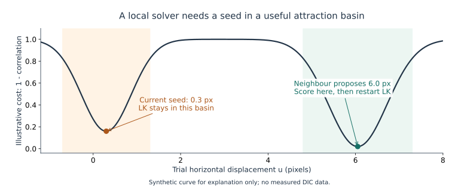
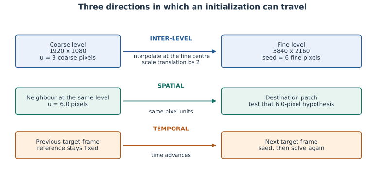
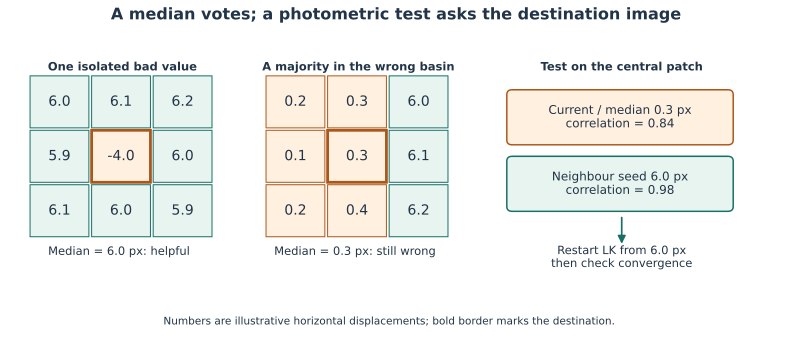
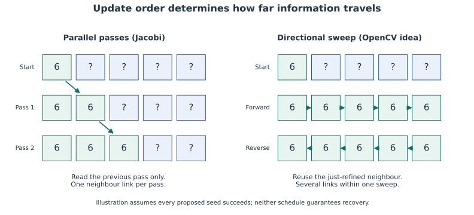
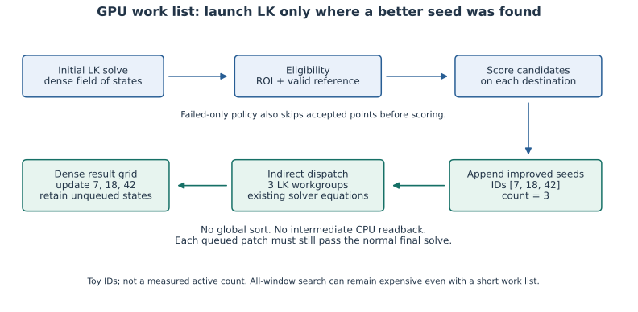
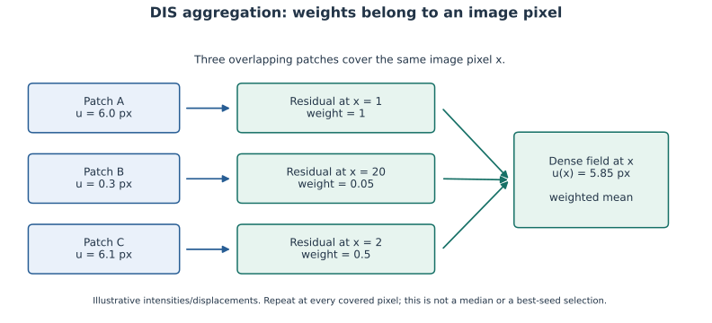

.. _seed-propagation:

Seed propagation: an illustrated reference
==========================================

**A neighbour can suggest where to search. The destination patch must still
measure its own displacement.** This is the central idea of propagation.
It can recover matches that independent local solves miss, without changing
the reference image or rebuilding its Hessians.

This page assumes engineering knowledge, not prior optical-flow experience.
Read the first three sections in order, then use the comparison tables as a
reference. All diagrams and their numerical values are original teaching
examples, not experimental images or benchmark measurements.

.. important:: Availability

   The browser workbench now exposes experimental failed-point propagation in
   **Analysis → Solve → custom solver → GPU seed propagation**. It uses the
   shared WGSL, requires translation/B-spline, CPU reference preparation and one
   slot, and is disabled by default. ``DICEngine`` exposes
   ``spatialPropagationPasses``; the ordinary native Python constructors retain
   their APIs, with propagation still available as a Python research host.
   See :doc:`../how-to/run-in-browser`, :doc:`js-api`, and :doc:`performance` for
   activation, exact scope and the distinction between native and GUI evidence.

.. contents:: On this page
   :local:
   :depth: 2

1. What is a seed, and why can LK need help?
--------------------------------------------

A subset is a small square of the reference image. A local solver such as
Lucas--Kanade (LK), here implemented as inverse-compositional Gauss--Newton
(IC-GN), adjusts its displacement to match a target image. In translation mode
the unknown is a pair of numbers, :math:`(u,v)`, in pixels.

The **seed** is the initial estimate supplied before those iterations. It is
neither a final displacement nor another reference image. A good seed lets
small local corrections reach a useful match. A bad seed can lead to another
local minimum, especially with repeated texture or a large deformation.
More iterations from that same seed may remain in the same minimum.

   Starting closer to a useful minimum can matter more than iterating longer
   inside the wrong one. This one-dimensional curve illustrates a problem
   that actually has at least two displacement coordinates.

An accepted status means the numerical checks and configured convergence and
correlation criteria passed. It does **not** prove the physical correspondence
is correct. For example, a repeated pattern may yield a plausible wrong match.
Propagation enlarges the search opportunities; it does not replace validation.

.. list-table:: Terms used below
   :class: propagation-table
   :header-rows: 1
   :widths: 22 78

   * - Term
     - Practical meaning
   * - Seed / initial guess
     - Displacement proposed before a local solve.
   * - Candidate / hypothesis
     - One possible seed, still to be tested on the destination patch.
   * - Photometric score
     - Similarity of the reference and displaced target intensities. It is
       not a probability that the displacement is correct.
   * - Attraction basin
     - Range of starting estimates that lead the local optimizer toward
       the same minimum.
   * - Propagation pass
     - One round of sharing hypotheses and, where needed, solving again.
   * - Filtering a measurement
     - Changing the returned field after its local solve. This has a
       different metrological meaning from changing only its seed.

2. Three different kinds of propagation
---------------------------------------

erence.
   :width: 100%

   Between levels, between neighbouring patches, and between target frames:
   these are different directions of information transfer.

**Between pyramid levels.** Solve a reduced image, interpolate that coarse
field at the correctly mapped fine patch centres, and convert displacement
units before the fine solve. At a factor-two change of resolution, 3 coarse
pixels represent 6 fine pixels. The existing coordinate-centre conventions
must also be respected; copying array indices is insufficient.

A 32-pixel coarse window spans 64 fine-image pixels at that scale ratio.
Adding levels therefore changes physical support as well as capture range.
A coarse window crossing several motion regimes can be a poor local model.
More scales do not guarantee a better initialization.

**Between spatial neighbours.** A nearby subset may already have found the
useful basin. Its displacement becomes a candidate for the current subset,
at the same image level and in the same pixel units. This is the spatial
propagation studied here; it complements the coarse-to-fine transfer.

**Between target frames.** The last target's field, or a velocity prediction,
can initialize the next target. In fixed-reference operation the reference
stays the first image; only the initial estimates evolve. See
:doc:`../explanation/temporal-initialization`.

These are translation examples. Affine gradients and quadratic curvatures have
different coordinate/scaling rules. A neighbour polynomial must be recentered
before comparing it at another position; blindly copying its whole coefficient
vector changes its meaning. This research propagation host rejects those
models rather than silently applying translation rules to them.

3. How a neighbour becomes a useful seed
----------------------------------------

Suppose patch B has a suspicious result and nearby patch A proposes
:math:`(u_A,v_A)`. Evaluate the **reference pixels of B** against target pixels
shifted by that proposal. A's own correlation score is irrelevant to this test:
the texture and motion may differ between A and B.

For the translation prototype, let :math:`F_B` be B's reference intensities
and :math:`G_B(s)` the target intensities sampled at candidate displacement
:math:`s`. The score is normalized correlation:

.. math::

   \rho_B(s) =
   \frac{\sum (F_B-\overline{F_B})
                    (G_B(s)-\overline{G_B(s)})}
        {\sqrt{\sum(F_B-\overline{F_B})^2\,
                     \sum(G_B(s)-\overline{G_B(s)})^2}}.

Higher is better. The sums use the destination window, not a mixture of
different neighbours' image scores. Zero-contrast and out-of-image candidates
cannot supply a useful comparison.

The research candidate set contains the current displacement, an original
prior when available, and permitted direct neighbours. Its sequence is:

1. Score the current estimate on B to establish a baseline.
2. Score each permissible candidate on those same B pixels.
3. If a sufficiently different candidate improves the score, use it as a seed.
4. Run B's normal IC-GN solve, using B's reference and Hessian.
5. Apply the normal convergence, support and correlation checks to that solve.

For the current GPU experiment the score improvement must exceed 0.0001 and
the displacement change must exceed 0.001 px. These are **candidate-search
gates**, not new uncertainty estimates or replacements for the final IC-GN
tolerance/acceptance threshold. Scoring uses raw-intensity bilinear samples;
the final local optimization retains B-spline interpolation.

A seed with a better initial score does not guarantee a more accurate final
fit. The all-window experiment restores an originally accepted state when its
trial re-solve fails. A rejected point is not converted into an accepted
measurement merely because a neighbour supplied a vector.

4. Why the median helps some errors and misses others
-----------------------------------------------------

A median uses the spatial distribution of available numbers. It can suppress
an isolated extreme value without comparing any images. That is useful when
most neighbours represent the same local motion and the bad estimates are
in the minority.

   A majority vote can stay in the wrong basin. Image evidence can favour a
   minority hypothesis. Colours indicate the illustrative basin, not actual
   solver statuses. Availability/status restrictions are omitted in this toy.

In the right-hand example, the median is 0.3 px because most entries are near
0.3. Repeating it cannot create a seed near 6 px. The photometric test instead
finds that a minority neighbour's 6-pixel proposal explains the central patch
better, then asks LK to refine it. Both illustrated scores could pass a 0.8
correlation threshold: acceptance alone cannot resolve that ambiguity.

If the 0.3-pixel result is already accepted, **failed-only search would skip
it**. This example explains the full candidate-search principle; recovering
such an accepted wrong basin requires reevaluating that point as well.

Four operations must be distinguished:

.. list-table:: Median contracts
   :class: propagation-table
   :header-rows: 1
   :widths: 24 36 40

   * - Operation
     - Input and action
     - Meaning of the final result
   * - Public ``outlier_policy="median"``
     - Smooth accepted states at every executed level, including the finest.
     - Returned measurements are filtered. Statuses are preserved and the
       filtered field is not re-optimized. This is explicit smoothing.
   * - Research ``median``
     - Apply the existing accepted-state median only before coarse-to-fine
       transfer; the filtered buffer really supplies the seeds.
     - The fine solve is still raw. An unavailable own coarse point is not
       filled by this measurement-median rule.
   * - Research ``seed-median``
     - Include finite, numerically admissible status-0 coarse estimates as
       well as accepted ones. Require at least four permitted stencil samples;
       include the centre when eligible.
     - Change only an initialization buffer. An unavailable own seed needs
       four eligible neighbours; a fine measurement still needs its own solve.
   * - Research ``median-candidate``
     - Construct a median hypothesis, score it on the destination, and
       selectively re-solve when it improves initialization.
     - The median is a tested proposal, not the reported measurement.

In these research controls the median stencil is 3 by 3 subset-grid cells.
The public median policy also offers larger stencils; those are a separate
smoothing choice. See :doc:`../explanation/displacement-outliers` for exact
public policies, recentering, validity gates and widths.

Status 0 is not an accepted measurement. It can still contain a finite
estimate useful for initialization. Excluding every such estimate from a
median is a different operation from filtering a seed field. Conversely,
admitting it as a seed never certifies its accuracy. Independent GPU tests
compare both coarse medians with NumPy and verify the actual transfer to fine
seeds, so a median pass cannot appear to work while its output is ignored.

A component-wise median of :math:`u` and :math:`v` can also produce a vector
that no neighbour had. It may attenuate a real narrow deformation band or mix
motion across a discontinuity if the neighbourhood is not restricted. It
should therefore remain explicit about its role and support.

5. Parallel passes are not directional sweeps
---------------------------------------------

   Idealized one-dimensional propagation, conditional on every proposed match
   succeeding. A question mark denotes an unresolved patch, not a zero vector.

**Parallel / Jacobi.** Every patch reads the field as it existed before the
pass. Results produced by one workgroup cannot influence another during that
same candidate dispatch. One pass therefore carries information at most one
neighbour link in this local stencil; repeated passes can reach farther.
Independent workgroups suit GPU execution and avoid order-dependent races.

**Directional / Gauss--Seidel-like.** Visit patches in order and reuse the
just-refined preceding patch. Successful information can travel several links
in one sweep. Reversing the sweep makes opposite-direction hypotheses available.
Implementations may use stripes that limit cross-stripe reuse. Parallelizing
all those dependent patch updates changes the algorithm, not just its speed.

There is no portable global barrier between workgroups inside one GPU
dispatch. The research prototype uses ordered dispatches for parallel passes;
it does not claim to reproduce OpenCV's full sweep reach in two passes.
Coarse-to-fine transfer, spatial pass count and temporal initialization are
therefore separate design choices.

6. The naive experiment and the compact GPU strategy
----------------------------------------------------

The ordinary production pyramid remains a useful baseline: solve each level
once and transfer its field to the next. It does not perform the research
spatial-candidate search below. Calling that baseline "naive" would obscure
which extra operation is actually being measured.

Here **naive propagation** refers to the first research implementation:
read whole fields back to Python, evaluate neighbour hypotheses on CPU, upload
new seeds, and run complete extra level solves. It established a robustness
effect, but repeated transfers, full candidate scoring and full re-solves
made it unsuitable for live processing.

.. list-table:: What work is actually performed?
   :class: propagation-table
   :header-rows: 1
   :widths: 24 25 26 25

   * - Strategy
     - Where are candidates scored?
     - Which extra local solves run?
     - Main limitation
   * - Ordinary pyramid
     - No research spatial search.
     - No extra spatial pass.
     - A bad coarse seed may persist.
   * - Naive CPU research oracle
     - CPU, on every admissible destination; intermediate field readbacks.
     - Full selected grid after each extra pass.
     - Too much CPU work and repeated data movement.
   * - Exhaustive GPU search
     - GPU, on every admissible destination, including accepted ones.
     - Only points with improved, sufficiently different seeds.
     - A short re-solve list does not make exhaustive scoring cheap.
   * - Failed-only GPU search
     - GPU, skipping accepted destinations before candidate scoring.
     - Only improved seeds among the eligible rejected points.
     - Cannot fix an already-accepted wrong basin.

nged.
   :width: 100%

   Compaction stores the indices of needed work, not a sorted field. There is
   no intermediate CPU decision; each queued point still runs the real solver.

Each scoring workgroup may append one index to a GPU list using an atomic
counter, which gives it a unique slot. A small kernel converts the final count
into an indirect dispatch size. The next dispatch launches one LK workgroup
per listed subset; empty lists launch no local iterations. The output remains
the original dense grid, with its coordinates, exclusions and statuses.
There is no need to sort by score or to rebuild references/Hessians.

Schematically, for one level:

.. code-block:: text

   solve the ordinary level
   repeat the requested number of spatial passes:
       read a stable field for this pass
       skip excluded / reference-invalid destinations
       optionally skip already-accepted destinations
       score permitted seeds on each remaining destination patch
       append only improved seeds to the GPU work list
       dispatch the unchanged local solver indirectly on that list
       preserve accepted original states if their trials fail
   optionally prepare a coarse median seed field
   transfer to the next finer level, or materialize the final field

In failed-only mode accepted states never enter the trial list, so restoring
them is unnecessary. The current field remains stable throughout candidate
selection and need not be copied just to read it. All-window search instead
needs an immutable snapshot across the trial/restore sequence.

Eligibility does not mean that every rejection is recoverable. A textureless
reference cannot be repaired by borrowing displacement. An occluded patch may
have no target match. ROI exclusions are not failed measurements and must
never be filled. Neighbour and inter-level permissions must prevent crossing
excluded regions, including narrow cracks; a plausible numerical vector alone
does not authorize such a link.

7. How to read DIS alongside this implementation
------------------------------------------------

The original `DIS paper <https://arxiv.org/html/1603.03590v1>`_, section 2.2,
combines patch matches into a dense field using photometric weights. A patch
with lower intensity residual contributes more at a pixel it covers. This is
an overlap-weighted average, not a 3 by 3 median. Excessive local updates are
reset; variational refinement is a separate step. That dense estimate then
initializes the next scale. Our earlier centre-sampled weighting experiment
did not reproduce the complete dense aggregation.

   Reading the paper's aggregation: the weight is local to an image pixel,
   not one permanent confidence assigned to an entire patch. Values are toy
   examples, with residuals in 8-bit gray levels and horizontal displacement
   in pixels. The current GPU prototype does not implement this full dense step.

At a pixel :math:`x` covered by several patches, a simplified translation-only
reading is

.. math::

   w_i(x) = \frac{1}{\max(1, |G(x+u_i)-F(x)|)},\qquad
   u_{\mathrm{dense}}(x) =
       \frac{\sum_{i:\,x\in\Omega_i} w_i(x)\,u_i}
            {\sum_{i:\,x\in\Omega_i} w_i(x)}.

The same patch can therefore contribute strongly at one pixel and weakly at
another. Combining its overlapping proposals yields a dense field, whose
values need not equal any single proposal. That operation differs from
choosing one seed for a subset and re-solving that subset.

The `OpenCV 5.0.0 source
<https://github.com/opencv/opencv/blob/5.0.0/modules/video/src/dis_flow.cpp>`_
adds directional spatial candidates. ``PatchInverseSearch_ParBody`` compares
two neighbours per sweep, shares the iteration budget between sweeps, and
stops when SSD no longer decreases. ``Densification_ParBody`` performs the
weighted aggregation. Our GPU prototype uses parallel passes, up to eight
neighbours, normalized correlation and extra native solves. These are distinct
implementations; equal patch size does not imply equal work or equal output.

8. What the evidence does and does not establish
------------------------------------------------

The :doc:`performance` reference is the canonical location for numerical and
timing tables. Its archived campaigns distinguish the CPU oracle, GPU policies
and OpenCV presets. They retain original UHD inputs, exact settings, raw timings,
adapter information and analytic error populations. The ordinary-baseline
parameters, statuses and iterations are checked against the production engine.

The GPU controls verify useful hypotheses becoming real local solves,
unchanged unqueued states, empty/2-D indirect work lists, fixed-prior reuse,
correct median transfer and no intermediate queue readback. Public UHD truth
checks retain accuracy. Private difficult images show an acceptance gain;
without ground truth there, that gain alone is not an accuracy certificate.

The earlier CPU study disabled medians. It did not demonstrate their
ineffectiveness. Subsequent controls distinguish a correct median of accepted
measurements from a median of initialization estimates; their effects differ.
Likewise, a low error on a smooth field can reward smoothing without proving
robustness. Noise, narrow features, discontinuities, repeated texture and
false candidates need separate controls.

Propagation is an important robustness mechanism when initialization is the
limiting factor. It is not a substitute for an informative texture, a suitable
local motion model, valid image support or scientific acceptance criteria.
Whether one or several passes fit a real-time budget depends on how many
points need search, how much scoring is done and the tested hardware. A
throughput above 60 fields/s on an easy fixed pair does not certify every
difficult frame's latency, camera acquisition or storage at 4K60.

.. note:: Editable figures

   The diagrams are vector SVGs with text labels and prose alternatives.
   Their source is ``docs/figures/propagation.py``. With the optional authoring
   dependency Matplotlib, regenerate them using
   ``python3 DIC/LucasKanadeICGN/docs/figures/propagation.py`` from the repository
   root. The documentation build uses the checked-in SVGs directly and does
   not require Matplotlib or regenerate experimental fixtures.
