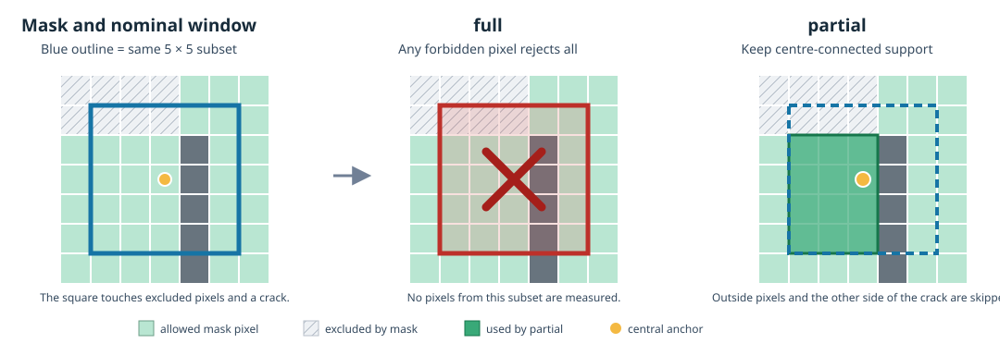

ROI and mask reference
======================

An ROI mask is a binary image in the **reference-image coordinate system**.
It determines which reference subsets may be measured and, for partial
subsets, which reference pixels contribute to their correlation equations.
It is prepared with the reference and remains fixed for that reference's
registrations. The target image is checked against image/interpolator bounds;
it is not tested against the reference mask at the deformed location.

.. list-table:: Mask support by entry point
   :header-rows: 1
   :widths: 28 22 22 28

   * - Entry point
     - ``full``
     - ``partial``
     - Default when a mask is supplied
   * - Native ``ICGNWGPU`` and ``ICGNWGPUFullPyramid``
     - Yes
     - Yes, translation and affine
     - ``full``
   * - ``ICGNBrowser(backend="webgpu-wgsl")`` / raw WebGPU core
     - Yes
     - Yes, translation and affine; CPU reference preparation and uniform integration
     - ``full``
   * - Standalone Analysis workbench
     - Yes
     - Yes, subject to the browser constraints above
     - ``partial``; choose **Full window** to require complete squares
   * - Three.js/TSL backend
     - No
     - No
     - ROI requests are rejected

The native and direct-engine defaults preserve the complete-window contract.
The workbench uses partial support by default so a small mask can still measure
subsets that straddle its boundary. Select the policy explicitly when results
must be reproducible independently of an interface preset.

   A subset that touches a forbidden pixel is entirely rejected by ``full``.
   ``partial`` keeps only the allowed 4-connected component containing its
   central anchor; the opposite side of a crack is not mixed into the same
   correlation calculation.

Input and validation
--------------------

For Python, pass ``roi_mask`` as a two-dimensional NumPy array with boolean
dtype and exactly the height and width of the reference after the engine's
normal grayscale conversion. ``True`` means allowed; ``False`` means
excluded. Integer 0/1 arrays, image arrays, and masks that need resizing,
thresholding, cropping or broadcasting are rejected. The engine snapshots the
mask during ``set_reference``; later edits to the caller's array do not alter
the prepared ROI.

For the JavaScript engine, ``roiMask`` is a row-major ``Uint8Array`` of exactly
``width * height`` entries, each either 0 or 1. It is copied during
``setReference``. The standalone workbench can construct this binary image
from vector geometry or import a binary image. Exact image import requires
opaque black and white pixels; threshold import explicitly uses rounded
BT.709 luminance and alpha at least 128. Dimensions must match. No implicit
contrast scaling or threshold is applied. See
:ref:`js-api-application-mask-image` for the image-import contract.

Both ``roi_policy`` / ``roiPolicy`` values are validated even when the mask is
absent. The only policies are ``"full"`` and ``"partial"``. The quadratic
motion model cannot be combined with a mask; without a mask, its existing
solver remains available. Three.js rejects ROI explicitly rather than
ignoring it. Browser engines also reject ``roi_truncation="visibility"``.

``full``: select whole nominal windows
---------------------------------------

For a subset of width ``S`` at its existing grid origin ``(x0, y0)``,
``full`` selects the subset precisely when

.. code-block:: python

   selected = mask[y0:y0 + S, x0:x0 + S].all()

Every pixel in the nominal square must be allowed. A single forbidden pixel
excludes it, including a hole entirely inside the square even when all four
corners are allowed. The implementation evaluates this condition from a
summed-area table prepared once; the mathematical rule is the same as the
direct slice above.

The subset grid is unchanged: mask boundaries do not shift centres, shrink
windows or change the stride. This applies to odd and even widths and to
overlapping grids. Supplying an explicitly eroded mask is the way to request a
geometric margin; no hidden margin is added.

No mask and an all-true mask use the historical solve path. An all-false mask
is valid: the dense result geometry is retained, but there are no selected
measurements and no per-frame IC-GN solve. A zero stored in an excluded result
cell is only a finite placeholder; it does not mean zero displacement.

``partial``: retain an informative local support
------------------------------------------------

Complete squares use the ordinary full-window solver. At a boundary, the
engine intersects the nominal square with the mask and retains only the
4-connected allowed component containing the subset's central anchor.
Disconnected islands in the square do not contribute. Grid origin, nominal
centre, stride and returned parameter convention remain unchanged.

An odd-width subset has one central pixel, which must be allowed. The centre of
an even-width subset lies between four pixels; all four must be allowed. If
the centre straddles the boundary, the subset is excluded rather than
arbitrarily assigned to one side. The affine model continues to use the
nominal subset centre, not the centroid of the retained pixels.

The support is static across target iterations. Its binary support is combined
with the selected spatial weighting for the reference mean and norm, Jacobian,
Hessian, target statistics and correlation sums. The actual sum of weights is
used. Pixels outside the support are skipped before target interpolation;
they are not neutralized by multiplying invalid values by zero. Reference
validity uses texture, rank and conditioning checks, not pixel count alone.
Thus a geometrically selected support may still be numerically inadmissible.

Native Python additionally exposes ``roi_truncation="visibility"`` with the
partial policy. This preparation-time geometric heuristic removes support
pixels whose centre-to-pixel segment touches forbidden pixels, reducing
wrap-around across a crack tip. It is inspired by Ncorr's subset-truncation
goal, but is not an implementation of Ncorr's contour algorithm. It can
remove useful pixels and cause rejection, especially for affine subsets. It is
not available in the browser and is never enabled implicitly. See
:doc:`../how-to/use-partial-roi` for the construction and qualification
details.

Pyramids, filters and initialization
-------------------------------------

Each coarser mask is prepared once using the image pyramid's decimation phase.
A coarse pixel is allowed only when **all 25 reflected source pixels** in the
5 by 5 footprint of the five-tap reduction are allowed. The footprint is
centred at source coordinate ``(2*x, 2*y)``. This conservative rule does not
close a narrow forbidden crack. The selected windows are then evaluated on
each level's unchanged grid. An all-true mask remains all true.

The pyramid, temporal initialization, Fourier initialization and reference
preparation use this static ROI plan. A selected fine subset remains eligible
when no admissible coarse seed exists; it uses the solver's normal zero-seed
fallback. A thin ROI may therefore reduce the capture range at coarse levels,
but does not by itself remove an eligible fine subset. Excluded destinations
are never reactivated by seed transfer or selective recovery.

UOD, median replacement/smoothing and seed propagation use precomputed ROI
permissions. They do not treat excluded subsets as failed measurements or
fill them. Neighbour and cross-level seed links are screened against the
reference mask so a filter or seed does not cross a crack. The conservative
link test requires the closed pixel box enclosing the segment between subset
centres to be allowed; around oblique boundaries this can reject some links
that do not visibly cross a crack. Insufficient neighbours retain each
operation's documented no-fill behaviour. Partial-window propagation is
subject to the solver's compatibility restrictions; it must not be inferred
from the fact that partial correlation itself is supported.

These masks, supports and link permissions are built at reference preparation.
The live loop does not upload the image mask, rebuild supports, or invert a new
reference Hessian per frame. Full-window ROI uses the existing solver
equations; partial windows are dispatched through their prepared support
solver.

Interpret selection and validity separately
--------------------------------------------

There are three distinct states:

* **ROI selection** is static geometry: whether a grid position is requested
  by the chosen policy. For native results, ``roi_selected`` is a boolean
  grid, or ``None`` when no mask was supplied.
* **Reference validity** is static numerical admissibility: whether the
  reference subset/support has enough texture and a usable Hessian. Use
  ``reference_valid``; it is independent of target convergence.
* **Solve status** is per target frame: whether IC-GN converged and passed its
  acceptance criteria. Use ``status`` and ``accepted_mask``.

For native ROI results, status ``-3`` means geometrically excluded; it is not
a failed correlation. A selected but inadmissible reference or rejected
target remains a numerical failure according to the existing status
contract. ``populations`` reports total grid positions, selected and excluded
positions, admissible references and accepted/rejected selected solves.
Success rates use selected positions, not the entire grid, as their
denominator. Undefined statistics are ``None`` in Python and ``null`` in
strict JSON.

The workbench can display masked estimates or the categorical solver-status
map, but display choices do not change measurement validity. Use accepted and
reference-valid masks for statistics and downstream fields.

Provenance and exports
----------------------

An ROI configuration records the policy, truncation setting, mask dimensions,
SHA-256 hash, and selected/excluded counts per pyramid level. The canonical
hash input is the ASCII bytes ``live-dic-roi-v1``, one zero byte, unsigned
64-bit little-endian ``height`` and ``width``, then row-major C-order mask
bytes encoded as 0 or 1. The hash detects a changed mask but cannot reconstruct
it.

Native ``save_npz`` exports include the binary input mask and grid selection;
partial exports also include the local support words, support boxes, coverage
and available support diagnostics. Arrays remain numeric/bool and archives
are readable with ``allow_pickle=False``. The standalone results project
stores a shared binary mask with its fields and checks mask hashes on import.
The workbench's vector geometry and image-import conversion are additional
provenance; only applied geometry is represented as the active numerical
mask.

.. seealso::

   :doc:`../how-to/use-roi` gives a native Python workflow and mask benchmark
   example. :doc:`../how-to/use-partial-roi` gives the support geometry,
   conditioning rules and crack-tip qualification. :doc:`result-layout`
   defines result arrays and status values. :doc:`js-api` documents browser
   engine and workbench-specific mask input.
