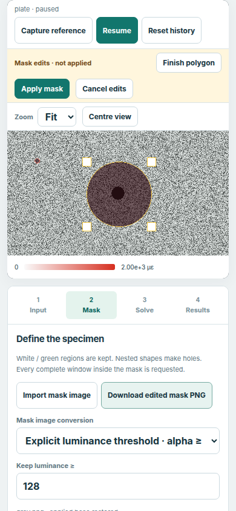
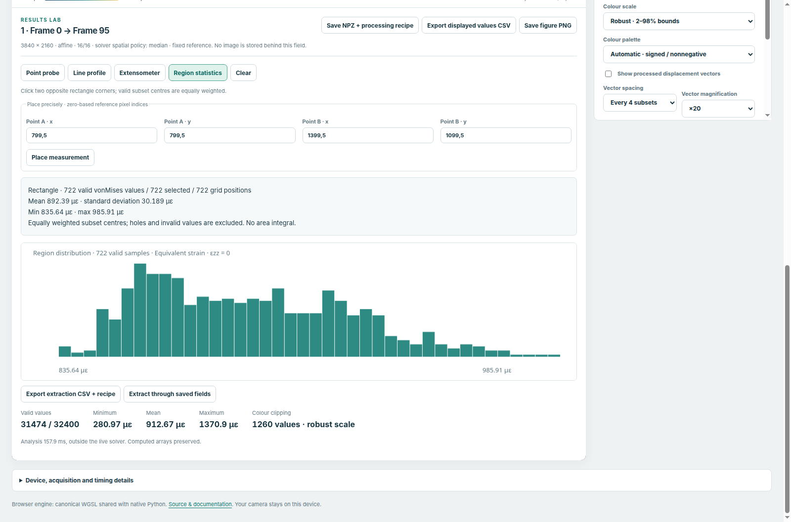
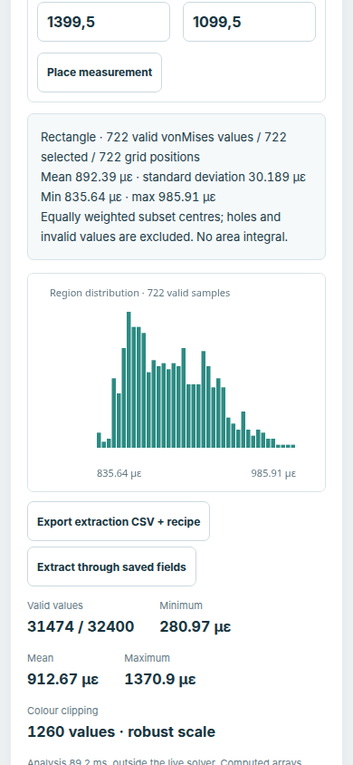

Your first visual DIC experiment
================================

This tutorial takes you from a checked-in UHD image pair to a saved displacement
and strain analysis. You need no camera and no GPU-programming knowledge. The
browser companion uses the numerical foundation established by
`Pierre Margerit <https://github.com/MargeritPierre>`_; native Python remains the
recommended supervisor for scientific NumPy measurement pipelines.

The exercise uses the original 3840 x 2160 plate-with-hole images. It does not
resize, tile or regenerate them. This is an observation window in an infinite
plate, not a finite specimen with traction-free outer image edges. The circular
hole is a physical boundary; the editable outer rectangle limits observation.

Open the workbench
------------------

From the checkout root, run:

.. code-block:: bash

   python3 tools/run_browser_app.py

On Windows, ``py -3 tools/run_browser_app.py`` is an alternative. The command
builds the local site, starts a localhost server and opens your usual browser.
Keep the terminal running. It uses Python's standard library and Git; there is
no npm build, server-side computation or remote image upload. Browser GPU flags
and profiles remain yours. If necessary, choose an installed browser explicitly:

.. code-block:: bash

   python3 tools/run_browser_app.py --browser chromium

Use a browser with WebGPU enabled. If WebGPU is unavailable, the application
still lets you open a saved NPZ field or results project for CPU analysis; it
cannot perform new correlations. See :doc:`../how-to/run-in-browser` for device
requirements and the separate GitHub Pages activation procedure.

Choose the experiment and inspect its reference
-----------------------------------------------

1. In **Input**, choose **Plate with hole · UHD**. Wait for preparation and the
   first static result. The source uses the original reference and load-95 PNG.
2. Read the source label and choose **Solve**. The applied summary tells you the
   actual model, interpolation, window/step, pyramid schedule and grid. Keep
   the preset for this exercise. Pending edits are not applied to an old field.
3. Choose **Mask**, then **Edit mask**. The displayed image is now the reference.
   The rectangle and circle are editable geometry; white/green preview pixels
   are kept and the hole is excluded.
4. Select a shape in **Regions & holes**, or click its outline. Move it, resize
   its handles, or enter its reference-pixel coordinates. A fully nested shape
   creates a hole; a domain inside a hole restores an island. Outer domains can
   be separate. Rectangle, ellipse, circle and polygon are available.
5. Use **Cancel edits** to restore the applied mask, or **Apply mask** to prepare
   the edited geometry. The selection accepts only complete nominal windows
   inside white pixels. Numerical failures stay distinct from ROI exclusions.

Define the mask from specimen geometry. The **Status** display makes failed
measurements visible without removing them from the requested ROI. A black/white
PNG at reference size is another exact mask input; no resizing is performed.
Threshold conversion of a nonbinary image is an explicit option.

   An archived editor qualification, showing touch-sized controls on desktop
   Chromium's emulated narrow viewport. This is not physical-phone qualification.
   The underlying image and mask remain UHD.

Understand what is displayed
----------------------------

Return to **Results**. In the live appearance controls, choose a displacement
component, magnitude, equivalent strain or **Status**. Arrows originate at
reference subset centres and use an explicit magnification. Equivalent strain
uses the documented ``ezz=0`` convention; it is not stress.

The accepted/selected counters have different roles. Selection describes the
geometric ROI. Prepared-reference admissibility describes numerical information
in the reference. Acceptance describes the current solve. Every selected ROI
window stays requested on the next image, even after a failed correlation.

For this static pair, **Play** recalculates the selected load. Choose the other
plate load to inspect a different target against the same reference. This is
not a live frame-rate benchmark.

Freeze a field and choose a strain calculation
----------------------------------------------

1. Choose **Inspect current field**. Acquisition pauses and the complete field
   is retained in the results library. The saved view uses reference coordinates;
   it does not put an old field over an unrelated current camera image.
2. Select **Equivalent strain**. The default analysis reads local model
   gradients. "Computed" includes the solver spatial policy shown in provenance;
   a solver median output is already spatially smoothed.
3. Select **Gaussian** displacement smoothing. Strain calculation switches to
   **VSG**, a plane fit to neighbouring displacements. Choose a 5 x 5 grid window
   and inspect the processing summary.
4. Compare **Infinitesimal** and **Green–Lagrange** strain deliberately. They
   describe different strain measures. Smoothing and fitting reduce spatial
   resolution; they are not a proof of robustness or an uncertainty estimate.
5. Use **Show computed field**, then **Restore processing recipe**. This comparison
   is temporary. Original parameters, statuses and iteration counts remain intact.

At 16-pixel windows/steps, a five-point smoothing neighbourhood spans 80 pixels;
smoothing followed by five-point VSG has a nominal 144-pixel strain support.
Near boundaries the support is reduced. The analysis does not fill holes or
average through an excluded crack. Translation-only fields require VSG to
estimate strain.

Length units are an explicit isotropic units-per-pixel scale. They do not provide
lens calibration, perspective correction or a new physical coordinate system.
Image x points right and y points down. Strain remains dimensionless.

   The archived workbench exercise uses the real UHD plate field and independent
   NumPy checks. Exact source/build identifiers and numerical comparisons are in
   the associated qualification reports. These screenshots are correctness
   evidence, not a measured live cadence.

Place and export a measurement
------------------------------

Click the field, or use **Place precisely** with zero-based reference pixel-index
coordinates. Measurements snap to actual subset centres.

* **Point probe** reports the value, position, solver status and iterations.
* **Line profile** samples actual subsets between two endpoints. Invalid points
  remain gaps; no displacement interpolation creates extra measurements.
* **Extensometer** uses two accepted endpoints. It reports endpoint-distance
  change and engineering gauge strain ``delta L / L0``. It can span a hole
  because it uses endpoints, not a continuous material line. It is distinct
  from a local tensor strain.
* **Region statistics** uses two opposite rectangle corners. It reports total,
  selected and valid counts, mean, dispersion and extrema. Samples have equal
  weight; with overlapping windows this is not a material-area integral. Its
  histogram uses the same selected rectangle. Status codes have categorical
  counts, never a scalar mean.

Choose **Export extraction CSV + recipe**. Retain both files: CSV holds values
and missing entries, while JSON records units, geometry and processing.

   The selected region has its own valid population and distribution. Whole-field
   statistics remain separate below. Narrow-viewport rendering was tested in
   desktop Chromium emulation.

Record and compare multiple fields
-----------------------------------

Return to live view and enable **Keep computed fields for review**. Change the
plate load to obtain another stored field. For your own sequence, use
**Open image folder**, **Select images**, **Open video** or **Camera** instead.
Folder images are processed in natural filename order; video uses its browser
decoder. A camera shows negotiated settings separately from requested settings.

**Fixed reference** compares every target with the captured reference.
**Consecutive images** performs a new solve against the immediately preceding
input, including after a numerical failure. Those increments are not accumulated
material trajectories. Their reference preparation costs are included in result
age; they do not inherit fixed-reference FPS claims.

Use the saved-field slider or **Previous/Next result**. **Apply recipe to matching
fields** gives compatible results the same derived processing. **Replay matching
results · 2 Hz** waits for each analysis and only visits that analysis epoch,
ROI, grid and reference mode. Its presentation rate is not acquisition time.

Place a point, gauge or region and choose **Extract through saved fields**.
The chart uses saved order, retains failure gaps, and reports a region's changing
valid sample count. It does not infer uniform sampling or integrate consecutive
increments. Progress can be cancelled.

Save an experiment for later review
-----------------------------------

* **Save results project** pauses acquisition and stores all computed fields,
  shared masks, provenance and applied recipes in one ``.dicproject`` archive.
  It waits for a requested analysis update before capturing its applied recipe.
  Keep original images separately. Opening a project adds its results without
  replacing the current acquisition source or solver settings.
* **Save NPZ + processing recipe** creates a self-contained individual field
  for NumPy. Computed and processed arrays have separate names and validity
  masks. ``parameter_order`` and metadata identify raw coefficients and units.
* **Export displayed values CSV** exports the selected quantity. Unavailable
  measurements remain empty. **Save figure PNG** includes the quantitative colour
  bar (or all six status categories), reference/target label, subset geometry,
  processing convention, measurement annotation and attribution. Keep the NPZ
  or project for numerical data and complete provenance.

For example, an NPZ can be read with no pickle:

.. code-block:: python

   import json
   import numpy as np

   with np.load("live-dic-1.npz", allow_pickle=False) as field:
       raw_parameters = field["parameters"]
       names = field["parameter_order"]
       exx = field["processed_exx"]
       valid = field["strain_valid"].astype(bool)
       recipe = json.loads(str(field["recipe_json"]))

Native quadratic NPZ imports additionally expose computed displacement second
derivatives in the quantity selector. These are explicitly separate from
Gaussian/VSG displacement processing. Changing units scales their presentation;
it does not rewrite raw coefficients. Browser acquisition remains affine or
translation.

The library holds at most 128 MiB of stored arrays, distinct masks and metadata.
At capacity, recording and acquisition pause without discarding saved fields.
Analysis scratch and GPU/decoder memory are additional. There is no automatic
disk persistence. Check your downloaded project before closing; a browser unload
warning is only an accidental-loss guard. Camera restart captures a new reference
and requires reapplying its mask. Physical cameras, mobile browsers and calibrated
experimental metrology need their own qualification.

Continue with :doc:`first-registration` and :doc:`realtime-sequence` for the
native NumPy pipeline, or :doc:`../explanation/browser-workbench` for the analysis
and archive contracts.
